## 文档信息

| 字段 | 内容 |
|------|------|
| 产品名称 | 观严平台代扣代缴 |
| 文档版本 | V3.7 |
| 创建日期 | 2026-10-29 |
| 最后更新 | 2026-11-18 |
| 文档范围 | 后台开关、知情同意书签署、费用申请、税费测算、增附税税点配置、协议管理、申报管理、提现与打款、公司打款账号管理 |
| 目标读者 | 产品团队、研发团队、测试团队 |
| 设计来源 | 《观严平台代扣代缴设计方案V2.5》 |
| V3.0 变更说明 | 同步视觉设计稿（C端全部页面），更新签署流程为3步、提现金额系统自动填入、税费测算直接使用税前收入计算个税、新增未实名态/未实名拦截/实名认证页/空状态设计，快照替换为视觉稿截图 |
| V3.1 变更说明 | 同步管理端视觉设计稿（P1/P2/P3/P4/P5/P6/P7/P8），基于观严后台配色；删除扣税明细页(C6)、恢复收益明细页(C4-1) |
| V3.2 变更说明 | 协议版本增加有效期（X年），到期触发重签（新增操作类型"协议到期重签"）；增附税税点配置增加有效期范围（起止日期）；税费测算页计算公式移至计算明细卡片顶部展示，不展示预扣率表 |
| V3.3 变更说明 | 增附税资金流向变更：从"平台代缴后与上游结算"改为"从用户余额扣收"（与知情同意书4.5条对齐）；C端展示预估增附税；个税+增附税同时预估同时实扣；税费测算增加增附税测算；连续劳务起征点从P5配置获取（非固定10万），代垫机制确认为公司代垫后与上游客户结算 |
| V3.4 变更说明 | 税费测算改为所有用户可见（含云账户用户）；删除增附税三阶段展示（免征区/预警区/征收区），简化为阈值判定；连续劳务报酬（适用累计预扣法）增附税预估双条件：单笔>1,000元 + 月累计≥免税额度阈值，任一满足即展示 |
| V3.5 变更说明 | 协议版本管理简化：移除协议有效期（X年），发布新版本=旧版本自动停用；协议版本号改为手工输入（草稿状态可修改）；同一时间只能有一个已发布版本（不可停用唯一已发布版本）；移除"协议到期重签"操作类型和"已到期"状态；列表新增"备注"列；关闭观严代办不取消已签署授权，再次开启时若协议未更新则无需重签 |
| V3.6 变更说明 | 新增P7-3提现与打款（批量审核+生成观严打款文件5合1+导入银行回执）和P9公司打款账号管理；打款状态新增"待审核"环节；管理端导航重组为"代扣配置管理"分组（P1/P5/P9三Tab） |
| V3.7 变更说明 | P1代扣模式配置简化：人员列表和人员级开关移至用户管理，P1仅保留总闸开关；P9公司打款账号管理页面改为直接展示表单+保存（取代未配置/已配置双状态+弹窗模式）；P10-1个税代扣明细表从12列扩展为18列，新增6个累计计算字段（累计费用/累计减除费用/累计应纳税所得额/速算扣除数/累计应预扣税额/累计已预扣），记录审核通过后生成；新增4.12用户管理模块定义（用户列表+观严代办Toggle+4-Tab用户详情侧滑面板）；P7-1提现与打款列表新增"计算方式"列；原P2"人员代扣详情侧滑"重构为4-Tab用户详情面板 |

---

## 一、产品概述

### 1.1 产品定位

在观严平台现有"云账户代扣代缴"基础上，新增"观严代办申报"模式，实现平台自行代扣代缴个人所得税及增值税、附加税。增值税及附加税的纳税义务人为用户本人，平台代缴后从用户余额扣收，与个税同时预估、同时实扣。通过两层开关机制（总闸+人员开关）控制过渡期人员级差异化配置，最终实现全平台统一走观严代办。

### 1.2 目标用户

| 角色 | 使用场景 | 核心诉求 |
|------|----------|----------|
| 平台管理员 | 后台配置代扣模式、管理人员开关 | 灵活控制过渡节奏，清晰看到全局状态 |
| 劳动者（C端用户） | 签署知情同意书、费用申请 | 了解代扣模式、顺畅完成签署和费用申请 |

### 1.3 MVP 范围

**包含**：
- 后台：代扣模式配置页（总闸开关）、人员详情、总闸确认弹窗
- 后台：增附税税点配置（增值税率+附加税综合税率+减半优惠+免税额度阈值+生效时间）、协议管理（版本管理+签署位置配置+第三方电子签对接+签署记录查询）、申报管理（提现与打款+月度申报任务）、报表中心（个税代扣明细表+增值税计算明细表+上游客户结算表）、公司打款账号管理
- C端：知情同意书签署流程（含实名引导、选择计算方式、手写签名）、代办申报入口（个人中心）、费用申请签署拦截、余额冻结展示（未签署冻结）、取消授权、协议更新重签
- C端：税费测算入口（所有用户可见，输入含税结算收入，一键预估个税及增附税）
- 扣税时点：入账时全额进余额并展示预估个税及预估增附税，提现时展示预估个税及预估增附税，审核通过后计算实扣个税及实扣增附税，打款时执行代扣代缴

**不包含**：
- 操作审计日志页面（后端记录，后续迭代）

---

## 二、信息架构

- **观严代扣代缴**
  - **后台（管理员）**
    - 代扣配置管理（Tab 分组）
      - 代扣模式配置 —— 总闸开关（人员级开关在用户管理中配置）
      - 增附税税点配置 —— 增值税率 / 附加税综合税率 / 减半优惠 / 免税额度阈值 / 有效期范围（起止日期）
      - 公司打款账号管理 —— 公司名称 / 付款账号 / 银行名称 / 开户行（单账号）
    - 用户管理 —— 用户列表 + 观严代办人员级开关
    - 用户详情（4-Tab 侧滑面板） —— 用户详情 / 就诊人管理 / 问诊信息 / 观严代扣
    - 总闸关闭确认弹窗
    - 批量设置代扣模式弹窗
    - 协议管理
      - 协议版本管理 —— 新建版本（手工输入版本号） / 签署位置配置(签名位+盖章位) / 公司电子章 / 第三方电子签对接 / 发布版本 / 历史版本查看
      - 签署记录查询 —— 全平台签署流水 / 多维度筛选 / 导出
    - 申报管理
      - 提现与打款 —— 批量审核 / 生成观严打款文件（5合1） / 导入银行回执
      - 月度申报任务 —— 自动生成 / 申报状态 / 截止提醒
    - 报表中心
      - 个税代扣明细表 —— 按提现记录展示个税计算明细（含18列累计计算字段，审核通过后生成）/ 导出
      - 增值税计算明细表 —— 按入账记录展示增附税计算明细 / 导出
      - 上游客户结算表 —— 按月汇总增附税代缴数据 / 与上游客户结算
    - 500万预警用户列表 —— ≥400万用户统计 / 导出 / 通知标记
  - **C端（劳动者）**
    - 个人中心
      - 代办申报入口 —— 四态展示：未实名/未签署/已签署/需重签
      - 500万收入预警 —— 累计≥400万时显示预警横幅
      - 税费测算入口 —— 所有用户可见，输入累计税前收入 → 一键预估个税及增附税
      - 实名认证入口 —— 未实名用户引导入口
    - 知情同意书签署流程（3步）
      - Step 1：选择申报方式 + 勾选协议（合页）
      - Step 2：确认实名信息（底部弹窗）
      - Step 3：手写签名 → 授权完成
    - 实名认证流程
      - 实名认证页（姓名+证件号）
      - 认证完成页（根据签署状态引导下一步）
    - 协议更新/到期重签流程（3步，同签署流程，申报方式不可变更）
      - 重签Step1：阅读协议 + 勾选（申报方式置灰 + "不可变更"标签）
      - 重签Step2：确认实名信息（底部弹窗，无"保持不变"按钮）
      - 重签Step3：手写签名 → 重新签署完成
    - 取消授权流程
      - 授权记录页（卡片列表，签署蓝色左边框/取消灰色，可查看协议PDF）
      - 余额>0 阻断弹窗
      - 选择取消原因 → 状态回到未签署
    - 费用申请前置拦截
      - 进入前校验签署状态
      - 未实名 → 底部弹窗拦截（去认证/稍后再说）
      - 未签署 → 底部弹窗拦截（去签署/再想想）
      - 需重签 → 底部弹窗拦截（去重签/暂不签署）
    - 提现确认页 —— 系统自动填入提现金额（不可编辑）→ 展示预估个税 → 确认提现 → 提现结果页
    - 收益明细页 —— 每笔入账的收益信息，提供提现操作入口
    - 余额页面
      - 已签署：可用余额 + 预估扣税金额 + 提现按钮
      - 未签署/需重签：可用余额=0 + 冻结金额（"去签署"引导链接）
      - 提现记录列表（空状态设计）
    - 登录强提醒弹窗
      - 未签署 → 居中弹窗"您有待领取的金额"（去签署/稍后再说）
      - 需重签 → 居中弹窗"协议已更新，请重新签署"（去重签/暂不签署）
    - 空状态设计
      - 提现记录列表

---

## 三、核心用户流程

### 3.1 C端签署流程（T1 触发：实名完成时）

1. 完成实名认证 → 系统判断代办开关=开
2. 引导签署代办申报知情同意书
   - 未实名 → 去实名认证页 → 完成后根据签署状态引导（未签署→去签署，需重签→去重签）
   - 已实名
     - **Step 1（合页）**：选择申报方式（连续劳务报酬（适用累计预扣法） / 一般劳务报酬（使用按次预扣法），Radio 单选卡片）+ 勾选「我已阅读并同意《知情同意书》」
     - **Step 2（底部弹窗）**：确认实名信息（姓名、证件号码脱敏、申报方式），点击「确认无误」
     - **Step 3**：手写签名 → 点击「确认授权」→ 授权完成 ✓
   - 选择「再想想」→ 暂不签署
     - 状态=未签署
     - 费用申请时会被拦截

### 3.2 C端费用申请前置拦截（T2 触发）

1. 点击进入费用申请 → 系统校验签署状态
   - 已签署 → 正常进入费用申请页
   - 未实名（开关=开）→ 底部弹窗拦截
     - 标题：「请先完成实名认证」
     - 说明：使用费用申请等服务需先完成实名认证，认证通过后方可继续操作
     - 按钮：「稍后再说」/「去认证」
       - 去认证 → 关闭弹窗 → 跳转实名认证页 → 完成后回到签署/费用申请
       - 稍后再说 → 关闭弹窗，留在个人中心
   - 未签署（开关=开）→ 底部弹窗拦截
     - 标题：「您还未完成观严代办申报授权签署」
     - 说明：依据税收法律法规规定…（统一文案）
     - 按钮：「去签署」/「再想想」
       - 去签署 → 关闭弹窗 → 跳转签署流程 → 完成后回到费用申请页
       - 再想想 → 关闭弹窗，留在个人中心
   - 需重签（开关=开）→ 底部弹窗拦截
     - 标题：「协议已更新，请重新签署」
     - 说明：知情同意书已发布新版本（V1.1），重新签署后方可继续使用此功能
     - 按钮：「去重签」/「暂不签署」
       - 去重签 → 关闭弹窗 → 跳转重签流程 → 完成后回到费用申请页
       - 暂不签署 → 关闭弹窗，留在个人中心

### 3.3 后台发放冻结流程（T3 触发）

1. 后台发放费用 → 系统校验用户签署状态
   - 已签署 → 正常发放 → 全额进余额（展示预估扣税金额）→ 提现时展示预估个税 → 审核通过后计算实扣个税 → 打款时代扣
   - 未签署/未实名 → 发放后金额冻结
     - 通知用户（短信+Push+登录居中弹窗强提醒）
     - 用户签署后 → 冻结金额释放到可用余额 → 提现时展示预估个税 → 审核通过后计算实扣 → 打款时代扣

### 3.4 管理员配置流程

1. 登录后台 → 进入代扣模式配置页
   - 查看总闸状态 + 人员列表
   - 切换总闸 → 前置校验(云账户余额) → 确认弹窗 → 确认/取消
   - 搜索/筛选人员
   - 单个切换人员开关
     - 有余额 → 禁止操作（双向）
     - 观严→云账户：无余额 → 确认后切换
     - 云账户→观严 → 确认（提示需签署）
   - 批量设置 → 批量设置弹窗
   - 点击人员 → 人员详情侧滑（查看签署记录）

---

## 四、页面功能需求

### C端页面

---

#### 4.1 C1：个人中心——代办申报入口

> 📷 视觉稿快照：
> - 
> - 
> - 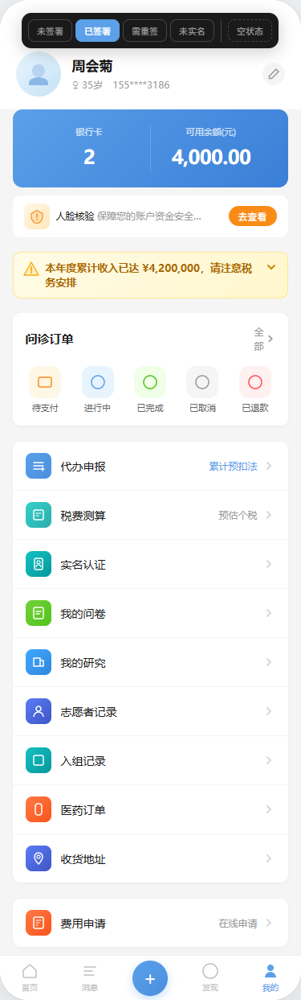
> - 

**页面目标**：观严代办用户从个人中心进入代办申报。

**入口条件**：「代办申报」菜单入口**仅"人员开关=开"的用户可见**，人员开关=关（云账户代办）的用户不显示。「税费测算」菜单入口**所有用户可见**（包括云账户代办用户），帮助用户在签署前了解代扣税费。

**状态展示**：

| 状态 | 入口展示 |
|------|---------|
| 未实名 | 「代办申报」+ 副标题「请先完成实名认证」（红色）+ 红点 |
| 已实名未签署 | 「代办申报」+ 副标题「请完成代办申报授权」（红色）+ 红点 |
| 已签署 | 「代办申报」+ 副标题「连续劳务报酬（适用累计预扣法）」（蓝色，显示当前申报方式） |
| 需重签 | 「代办申报」+ 副标题「请重新签署代办申报知情同意书」（橙色）+ 红点 |

**其他菜单项**：

| 菜单项 | 可见状态 | 说明 |
|--------|---------|------|
| 税费测算 | 所有用户 | 点击进入税费测算页（C10） |
| 实名认证 | 所有状态 | 点击进入实名认证页（C9），未实名用户额外显示红点 |

**余额卡片**：

| 状态 | 余额卡片展示 |
|------|------------|
| 未签署/需重签 | 冻结余额卡片（浅蓝渐变）+ 可用余额=0 + 冻结金额 + 「去签署」引导文字链接 |
| 已签署 | 正常余额卡片（蓝色渐变）+ 可用余额 + 预估个税 + 预估增附税（如适用） |

**点击跳转**：
- 未实名 → 实名认证页
- 已实名未签署 → 签署流程（3步）
- 协议更新/到期需重签 → 重签流程（3步，申报方式不可变更）
- 已签署 → 授权记录页（查看签署记录、取消授权入口）

---

#### 4.2 C2：知情同意书签署流程

> 📷 视觉稿快照：
> - 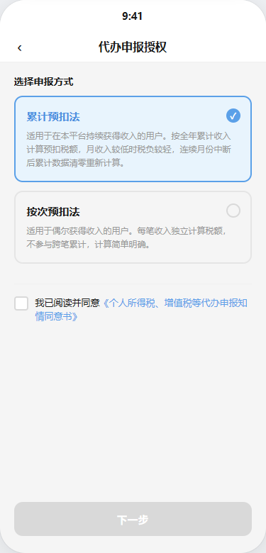
> - 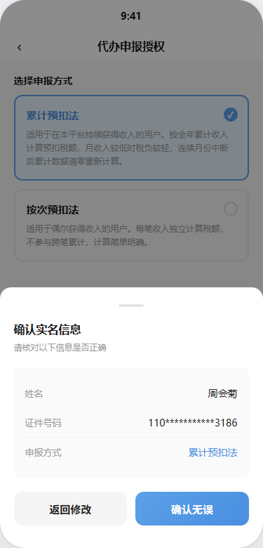
> - 
> - 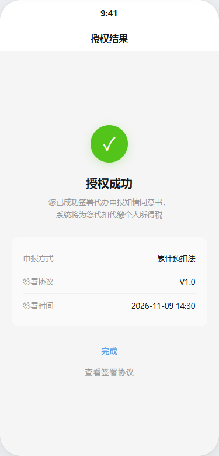

**页面目标**：引导用户完成代办申报授权签署。

**流程步骤**（共3步，无步骤进度条）：

| 步骤 | 形式 | 核心内容 |
|------|------|---------|
| Step 1 | 页面（合页） | 选择申报方式（Radio 单选卡片：连续劳务报酬（适用累计预扣法）/一般劳务报酬（使用按次预扣法），含说明文案）+ 勾选「我已阅读并同意《个人所得税、增值税等代办申报知情同意书》」 |
| Step 2 | 底部弹窗 | 确认实名信息：展示姓名、证件号码（脱敏）、申报方式，点击「确认无误」 |
| Step 3 | 页面 | 手写签名板，完成签名后点击「确认授权」 |

**Step 1 交互规则**：
- Radio 单选卡片选择申报方式，选中卡片高亮蓝色边框
- 必须同时选中申报方式并勾选协议复选框后，底部「下一步」按钮才可点击
- 点击协议链接可查看协议全文（PDF 叠层展示，z-index:200）
- 底部有「再想想」文字按钮退出，状态保持未签署

**Step 2 交互规则**：
- 底部弹窗展示确认信息（Sheet 样式）
- 按钮：「返回修改」（次要）/「确认无误」（主要）
- 无"保持不变"选项

**Step 3 交互规则**：
- 签名板支持手写，签名不能为空
- 底部并排：「上一步」（次要按钮）/「确认授权」（主要按钮）
- 完成后：显示授权成功页，同时系统将用户签名+公司电子章合成到协议 PDF 生成签署凭证，如有冻结金额则释放到可用余额（个税在审核通过后计算、打款时代扣）

**签署成功页**：
- 绿色勾图标 + 「授权成功」标题
- 说明文案 + 申报方式 + 协议版本号 + 签署时间
- 「查看签署协议」灰色文字链接（点击打开已签署协议PDF叠层，含用户手写签名+公司电子章，z-index:200）
- 「返回个人中心」文字链接

> 📷 签署完成效果——已签署协议PDF末页（含用户手写签名+公司电子章）：
> - 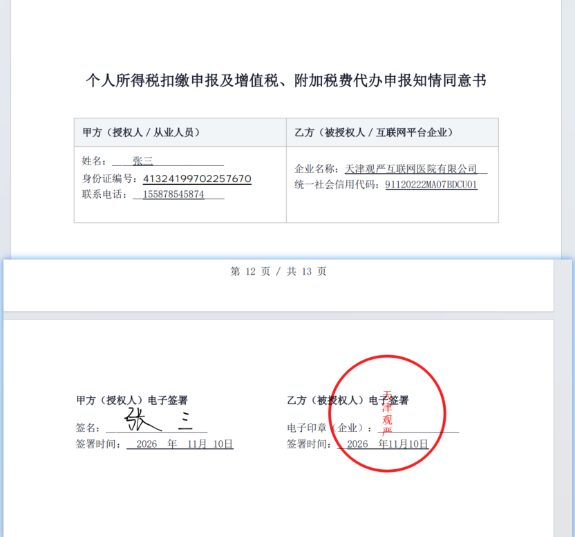

**连续劳务报酬（适用累计预扣法）说明文案**：
> 适用于在本平台持续获得收入的用户。按全年累计收入计算预扣税额，月收入较低时税负较轻，连续月份中断后累计数据清零重新计算。

**一般劳务报酬（使用按次预扣法）说明文案**：
> 适用于偶尔获得收入的用户。每笔收入独立计算税额，不参与跨笔累计，计算简单明确。

---

#### 4.3 C3：费用申请前置拦截

> 📷 视觉稿快照：
> - 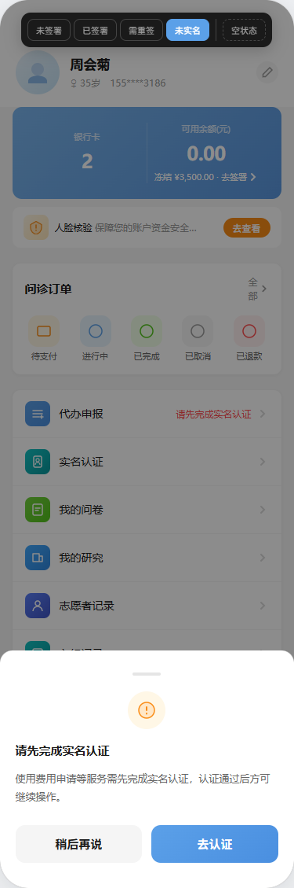
> - 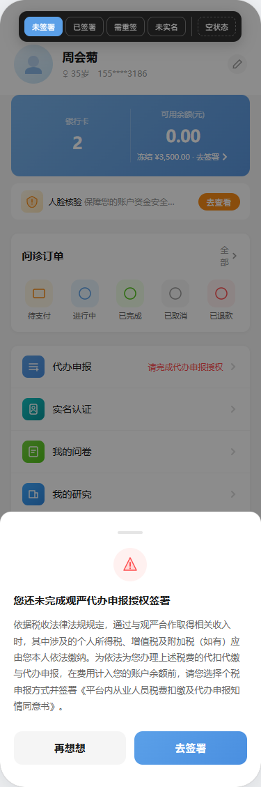
> - 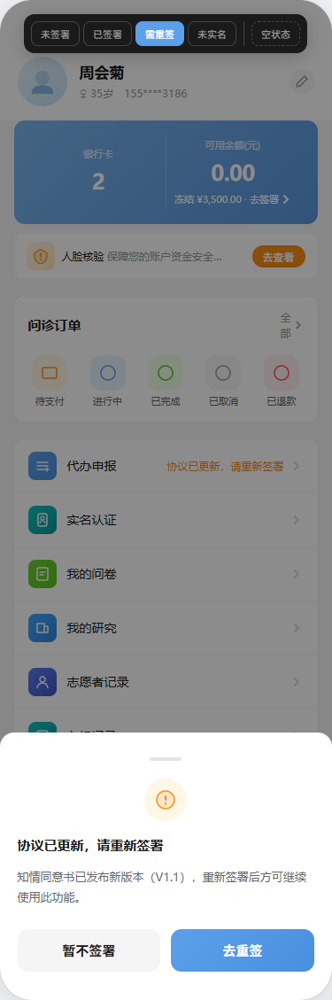

**触发**：用户点击进入费用申请时，系统校验签署状态。未通过校验时，弹出底部弹窗拦截，不进入费用申请页面。

**三种拦截场景**：

**① 未实名拦截**

| 元素 | 文案 |
|------|------|
| 图标 | 橙色圆形感叹号 |
| 标题 | 请先完成实名认证 |
| 说明 | 使用费用申请等服务需先完成实名认证，认证通过后方可继续操作 |
| 按钮 | 「稍后再说」（次按钮）/「去认证」（主按钮） |

**② 未签署拦截**

| 元素 | 文案 |
|------|------|
| 图标 | 红色三角感叹号 |
| 标题 | 您还未完成观严代办申报授权签署 |
| 说明 | 依据税收法律法规规定，通过与观严合作取得相关收入时，其中涉及的个人所得税、增值税及附加税（如有）应由您本人依法缴纳。为依法为您办理上述税费的代扣代缴与代办申报，在费用计入您的账户余额前，请您选择个税申报方式并签署《平台内从业人员税费扣缴及代办申报知情同意书》。 |
| 按钮 | 「再想想」（次按钮）/「去签署」（主按钮） |

**③ 需重签拦截**

| 元素 | 文案 |
|------|------|
| 图标 | 橙色圆形感叹号 |
| 标题 | 协议已更新，请重新签署 |
| 说明 | 知情同意书已发布新版本（V1.1），重新签署后方可继续使用此功能 |
| 按钮 | 「暂不签署」（次按钮）/「去重签」（主按钮） |

**通用交互**：
- 弹窗均为底部弹出样式（bottom sheet），z-index:100
- 点击「去签署/去认证/去重签」→ 关闭弹窗，跳转对应流程，完成后自动回到费用申请页
- 点击「再想想/稍后再说/暂不签署」→ 关闭弹窗，留在个人中心
- 已签署用户 → 正常进入费用申请页，无弹窗

---

#### 4.4 C4：余额页面

> 📷 视觉稿快照：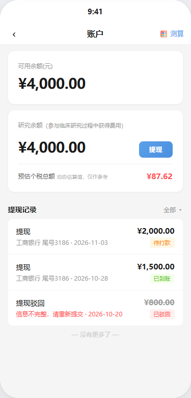

**页面目标**：展示用户余额，含可用余额、预估扣税金额、冻结金额和提现记录。

**内容**：

| 模式 | 展示内容 |
|------|---------|
| 云账户模式 | 可用余额（一笔） |
| 观严-已签署 | 可用余额 + 预估个税 + 预估增附税（正常蓝色渐变卡片）+ 「提现」按钮 |
| 观严-未签署/需重签 | 可用余额=0 + 冻结金额（冻结蓝色渐变卡片）+ 「去签署」文字引导链接 |

**余额卡片交互**：
- 已签署状态：点击「提现」按钮进入收益明细页（C4-1）
- 未签署/需重签状态：点击「去签署」文字链接跳转签署/重签流程；点击「提现」时如需重签则弹出拦截弹窗

**预估扣税金额说明**：
- 每笔入账时，系统根据当前计算方式和累计数据预估应扣个税金额及增附税金额，展示在余额区域
- 增附税预估判定：连续劳务报酬（适用累计预扣法）下，单笔到账含税金额 >1,000元或月累计含税收入≥免税额度阈值时显示预估增附税；一般劳务报酬（使用按次预扣法）下，单次（日）含税收入 >1,000元时显示预估增附税
- 预估金额仅供参考，实扣个税和增附税在提现审核通过后按当时累计数据计算

**冻结金额说明**：
- 冻结原因：「待签署知情同意书」—— 费用已发放但未签署，金额冻结
- 未签署/需重签状态：全部余额冻结，可用余额=0，冻结金额区域展示「去签署」引导链接，点击直接跳转签署流程

**提现记录**：
- 余额页下方展示提现记录列表（待打款/已到账/已驳回）
- 空状态：无提现记录时显示空状态提示

---

#### 4.4.1 C4-1：收益明细页

> 📷 视觉稿快照：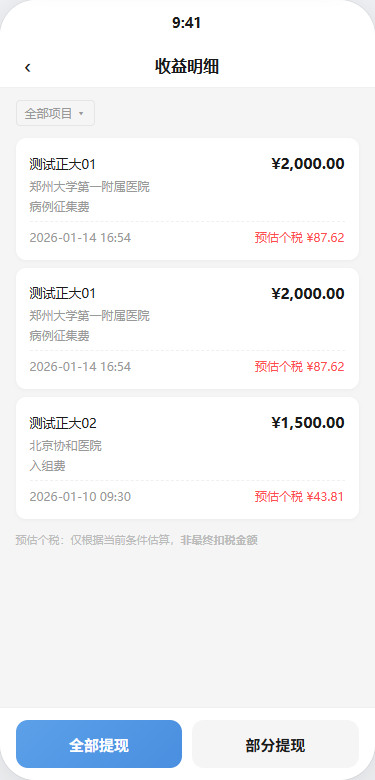

**页面目标**：展示用户收益明细，提供提现操作入口。

**入口**：余额页点击「提现」按钮 → 进入收益明细页。

**内容**：

| 信息项 | 说明 |
|--------|------|
| 筛选栏 | 「全部项目 ▾」筛选标签 |
| 收益列表 | 每笔入账的项目名称、金额、医院、费用类型、时间、预估个税、预估增附税（如适用） |
| 底部提示 | 「预估个税及增附税：仅根据当前条件估算，非最终扣税金额」 |

**底部操作**：
- 「全部提现」/「部分提现」按钮，点击进入提现确认页（C5）

---

#### 4.5 C5：提现确认页

> 📷 视觉稿快照：
> - 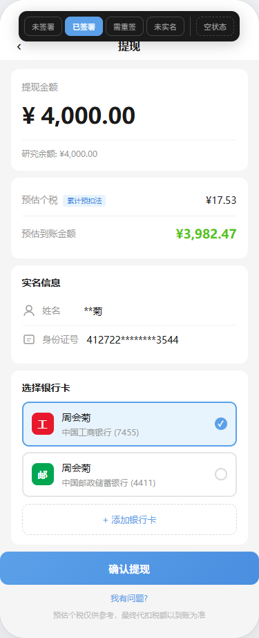
> - 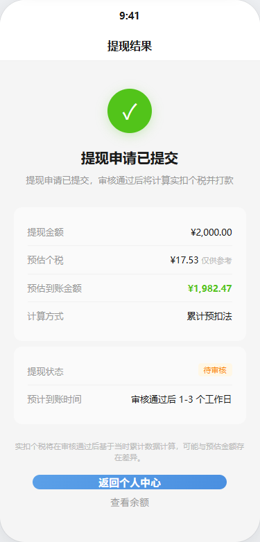

**页面目标**：用户提现时展示预估个税金额，确认后系统生成提现申请，审核通过后计算实扣个税并执行代扣代缴。

**入口**：收益明细页点击「全部提现」或「部分提现」→ 进入提现确认页。

**内容**：

| 信息项 | 说明 |
|--------|------|
| 可提现余额 | 当前可用余额金额 |
| 提现金额 | **系统自动填入**（根据用户选择的提现记录，不可编辑，无超额场景） |
| 预估个税 | 系统按当前累计数据实时估算，标注计算方式（连续劳务报酬（适用累计预扣法）/一般劳务报酬（使用按次预扣法）），仅供参考 |
| 预估增附税 | 系统按当前增附税配置实时估算（连续劳务报酬（适用累计预扣法）：单笔>1,000元或月累计含税收入≥免税额度阈值时适用；一般劳务报酬（使用按次预扣法）：单次（日）>1,000元时适用。阈值从P5配置获取），仅供参考 |
| 预估到账金额 | = 提现金额 − 预估个税 − 预估增附税，绿色大字高亮 |

**交互**：
- 提现金额由系统根据所选入账记录自动填入，用户不可手动输入或修改
- 不存在超额场景，不论是全部提现还是部分提现
- 预估个税基于当前最新累计数据估算（连续劳务报酬（适用累计预扣法）按当前累计链，一般劳务报酬（使用按次预扣法）按本笔独立计算），仅供参考
- 预估增附税基于当前增附税配置估算（连续劳务报酬（适用累计预扣法）：单笔到账含税金额>1,000元适用按次起征，月累计含税收入≥免税额度阈值适用月度起征；一般劳务报酬（使用按次预扣法）：单次（日）>1,000元适用按次起征。阈值从P5配置获取），仅供参考
- 点击「确认提现」→ 系统生成提现申请，状态为"待审核"
- 审核通过后，系统按审核通过时点的累计数据计算实扣个税，后续打款时按此税额代扣
- 确认提现后进入提现结果页

**提现结果页**：

| 信息项 | 说明 |
|--------|------|
| 提现金额 | 用户申请的提现金额 |
| 预估个税 | 提现时估算的个税，标注"仅供参考" |
| 预估增附税 | 提现时估算的增附税，标注"仅供参考" |
| 预估到账金额 | = 提现金额 − 预估个税 − 预估增附税 |
| 提现状态 | 待审核 / 审核通过/待打款 / 打款中 / 已到账 |
| 预计到账时间 | 审核通过后 1-3 个工作日 |

> **跨月说明**：如提现申请在2月提交、3月审核通过，实扣个税和增附税以审核通过时点（3月）的累计数据计算，打款时按该税额执行代扣。

> **预估与实扣差异说明**：提现页展示的预估个税和增附税基于提现时累计数据估算，审核通过后按当时累计数据计算实扣个税和增附税，两者可能因中间月份有新入账而存在差异。

---

#### 4.6 C7：授权记录页 + 取消授权流程

> 📷 视觉稿快照：
> - 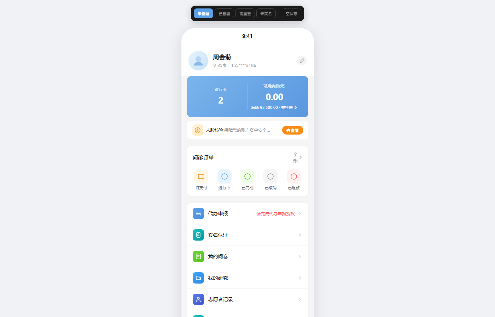
> - 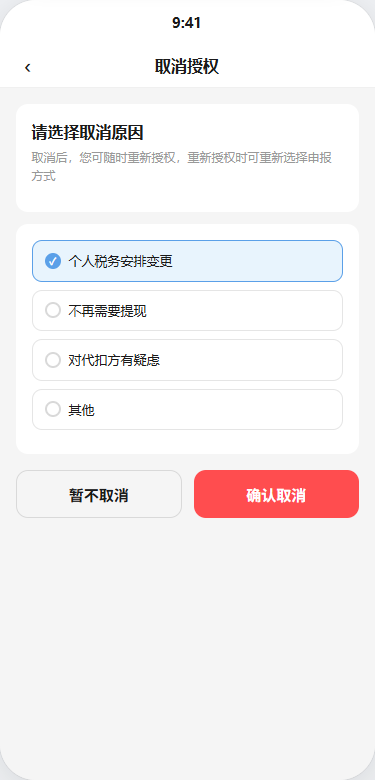

**入口**：个人中心 → 代办申报（已签署状态）→ 授权记录页

**① 授权记录页**

卡片列表，展示该用户所有签署与取消记录。**无空状态**——用户仅在已签署状态下可进入此页面，因此至少有一条签署记录。

**卡片样式规则**：
- 签署授权卡片：白色背景 + 左边框蓝色（#5BA0E8），"签署授权"标签蓝色
- 取消授权卡片：白色背景 + 无彩色左边框，"取消授权"标签灰色
- 当前生效中的签署记录右侧显示「取消授权 ›」入口（灰色文字，右上角）

**卡片信息项**：

| 信息项 | 说明 |
|--------|------|
| 操作类型标签 | 签署授权（蓝色）/ 取消授权（灰色）/ 协议更新重签（橙色） |
| 申报方式 | 连续劳务报酬（适用累计预扣法） / 一般劳务报酬（使用按次预扣法）（取消授权时无） |
| 状态 | 生效中（仅当前签署记录，蓝色Tag） |
| 时间 | 精确到秒 |
| 协议版本 | V1.0 / V1.1 等 |
| 查看协议 | 「查看协议」链接（签署成功时），点击打开已签署协议 PDF 叠层展示（含用户手写签名+公司电子章，z-index:200） |
| 取消原因 | 仅取消授权记录显示 |

**② 取消授权流程**

**前置条件**：余额=0 时才允许取消。

**流程**：
1. 授权记录页 → 点击「取消授权」→ 系统校验余额
2. 余额 > 0 → 弹出阻断底部弹窗：
   - 标题：「暂无法取消授权」
   - 内容：「您当前还有可提现余额 ¥X.XX。需全额提现后方可取消授权。」
   - 按钮：「暂不取消」/「去提现」
3. 余额 = 0 → 进入取消授权页面：
   - 页面标题：「取消授权」
   - 页面背景：灰色底 + 白色卡片
   - 提示文案：「取消后，您可随时重新授权，重新授权时可重新选择申报方式」
   - 必选取消原因（单选卡片）：
     - 个人税务安排变更
     - 不再需要提现
     - 对代扣方有疑虑
     - 其他（选中后下方出现独立文本输入框，最多50字，输入框不在卡片内）
   - 按钮：「暂不取消」（次要）/「确认取消」（主要，红色）
4. 确认取消 → 状态回到「未签署」，累计数据保留（不清零）

**重新授权**：
- 取消后可重新授权，重新授权时可重新选择计算方式
- 重新授权流程同 C2

---

#### 4.7 C8：协议更新/到期重签

> 📷 视觉稿快照：
> - 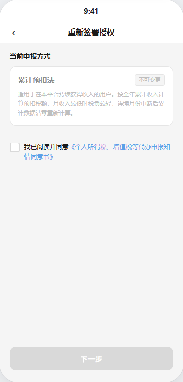
> - 

**触发条件**：
1. **协议更新重签**：后台发布新版本知情同意书 → 旧版本自动停用 → 已签署旧版本的用户状态变为「需重签」

**流程**：3步，同 C2 签署流程结构，但有以下差异：

**强提醒**：
- 癏录后居中弹窗强提醒（z-index:150），不罗列限制清单：
  - 协议更新：「协议已更新，请重新签署代办申报知情同意书」
- 个人中心代办申报入口显示红点 + 「请重新签署代办申报知情同意书」
- 需重签状态限制同未签署：费用申请/提现被拦截

**重签 Step 1（合页）与首次签署的差异**：
- 申报方式 Radio 卡片为**置灰不可选**状态：白色背景 + 边框 + 文字颜色降低 + 「不可变更」标签徽章
- 置灰状态**不使用 opacity 半透明**（避免整体视觉变暗），而是通过文字颜色降级和标签徽章传达不可编辑
- 协议勾选框正常可操作，勾选后「下一步」按钮激活
- 确认弹窗（Step 2 底部弹窗）无"保持不变"按钮，仅「返回修改」/「确认无误」

**内层页面不重复提示**：
- 外层登录弹窗已提示重签原因，重签页面内不再重复展示相同提示文案

**需重签状态限制**：
- 费用申请被拦截（C3 需重签拦截弹窗）
- 提现被拦截
- 签署后恢复所有功能

---

#### 4.8 C9：登录弹窗引导签署 + 实名认证

> 📷 视觉稿快照：
> - 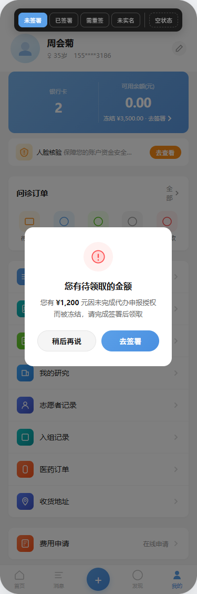
> - 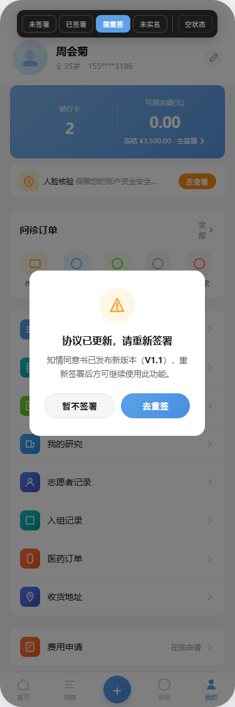
> - 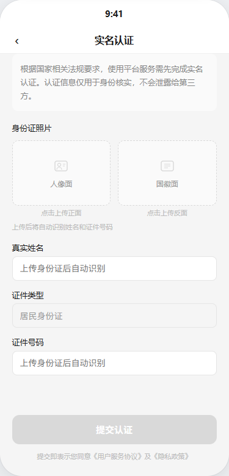
> - 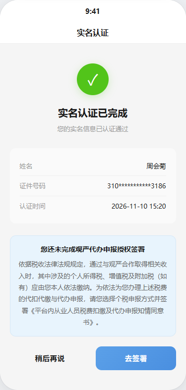

**① 登录强提醒弹窗**

**弹窗样式**：居中弹窗（modal，z-index:150），非底部弹窗，确保用户必须处理。

**两种场景**：

**未签署时（有冻结金额）**：

| 元素 | 文案 |
|------|------|
| 图标 | 红色圆形感叹号 |
| 标题 | 您有待领取的金额 |
| 说明 | 您有 **¥X,XXX** 元因未完成代办申报授权而被冻结，请完成签署后领取 |
| 按钮 | 「稍后再说」（次按钮）/「去签署」（主按钮） |

**需重签时**：

| 元素 | 协议更新重签 |
|------|-------------|
| 图标 | 橙色三角感叹号 |
| 标题 | 协议已更新，请重新签署 |
| 说明 | 知情同意书已发布新版本（**V1.1**），重新签署后方可继续使用此功能 |
| 按钮 | 「暂不签署」（次按钮）/「去重签」（主按钮） |

**交互**：
- 弹窗在登录后自动弹出，不可通过点击遮罩关闭（必须选择按钮）
- 点击「去签署/去重签」→ 关闭弹窗，跳转签署/重签流程
- 点击「稍后再说/暂不签署」→ 关闭弹窗，留在个人中心

---

**② 实名认证页**

**入口**：个人中心「实名认证」菜单项，或未实名拦截弹窗「去认证」。

**内容**：

| 信息项 | 说明 |
|--------|------|
| 姓名 | 文本输入框 |
| 证件号码 | 文本输入框 |
| 提交按钮 | 「提交认证」（主按钮） |

**交互**：
- 姓名和证件号码均为必填
- 提交后进入实名认证完成页

---

**③ 实名认证完成页**

**内容根据当前签署状态展示不同引导**：

| 当前签署状态 | 完成页展示 |
|------------|----------|
| 已签署 | 显示认证成功 → 「返回个人中心」按钮 |
| 未签署 | 显示认证成功 + 引导签署：「您已完成实名认证，请继续完成代办申报授权签署」→ 「稍后再说」/「去签署」 |
| 需重签 | 显示认证成功 + 引导重签：「知情同意书已更新，请重新签署」→ 「暂不签署」/「去重签」 |

---

#### 4.9 C10：税费测算

> 📷 视觉稿快照：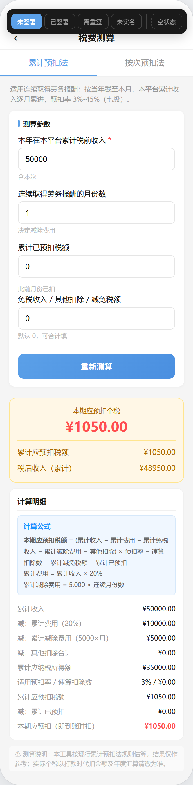

**页面目标**：让用户输入累计税前收入，一键预估个税及增附税，帮助用户了解打款时可能扣除的个税和增值税、附加税金额。

**入口位置**：个人中心 → 税费测算（**所有用户可见**，包括云账户代办用户；帮助用户在签署前了解代扣税费）。

**页面结构**：已签署用户根据已选计算方式，自动进入对应测算页面（连续劳务报酬（适用累计预扣法） / 一般劳务报酬（使用按次预扣法））；未选择计算方式的用户（未签署/需重签/云账户用户）默认进入连续劳务报酬（适用累计预扣法）测算页。顶部 Tab 可切换。

**核心设计原则**：用户输入**累计税前收入**，系统同时预估个税和增附税。个税直接以该金额作为计算基数，**不进行增值税换算**；增附税按增值税换算逻辑计算（不含税收入 = 含税收入 / (1 + 增值税率)）。

> 注意：C端税费测算为简化估算工具，个税部分用户输入的金额即作为基数直接计算（与后端实际计算中"不含税收入 = 含税收入 / (1 + 增值税率)"的换算逻辑不同）；增附税部分则按含税收入换算为不含税收入后计算。

---

##### C10-1：连续劳务报酬（适用累计预扣法）测算页

**顶部说明文案**：
> 适用连续取得劳务报酬：按当年截至本月、本平台累计收入逐月累进，预扣率 3%-45%（七级）。

**页面结构**（卡片分区，建立层次）：
- 测算参数区：白色卡片包裹，蓝色竖线标题"测算参数"
- 结果面板：暖黄摘要卡 + 白色明细卡
- 测算说明：灰底footnote

**计算公式展示**（位于计算明细卡片顶部，浅蓝底区域）：

| 公式项 | 说明 |
|--------|------|
| 本期应预扣税额 | = （累计收入 − 累计费用 − 累计免税收入 − 累计减除费用 − 其他扣除）× 预扣率 − 速算扣除数 − 累计减免税额 − 累计已预扣税额 |
| 累计费用 | = 累计收入 × 20% |
| 累计减除费用 | = 5,000 × 连续月份数 |

**① 测算参数区**

| 信息项 | 说明 | 默认值 |
|--------|------|--------|
| **累计税前收入** | 金额输入框，单位：元，提示文案「请输入累计税前收入」 | 空 |
| 连续取得劳务报酬的月份数 | 数字输入框，副标题「决定减除费用」 | 1 |
| 累计已预扣税额 | 金额输入框，副标题「此前月份已扣」 | 0 |
| 免税收入 / 其他扣除 / 减免税额 | 金额输入框，副标题「默认 0，可合计填」 | 0 |

**操作按钮**：「开始测算」（蓝色主按钮）

**② 结果面板**

| 卡片 | 说明 |
|------|------|
| 摘要卡（暖黄色背景 #FFF7E6） | 预估实际到账（绿色大字）+ 本期应预扣个税（红色）+ 增附税（红色，如适用） |
| 明细卡（白色背景） | 个税计算明细 + 增附税计算明细，始终可见 |

**增附税展示**：

> 起征点（免税额度阈值）从管理端P5增附税税点配置中获取，非固定值。以下以阈值=10万元为例说明。

| 月累计含税收入 | 摘要卡展示 |
|---------------|-----------|
| < 免税额度阈值（如 < 10万） | 仅显示个税；增附税显示"免征" |
| ≥ 免税额度阈值（如 ≥ 10万） | 显示个税 + 增附税金额（按当月全部累计含税收入计算） |

**③ 计算明细区**

| 项目 | 说明 |
|------|------|
| 累计税前收入 | 回显用户输入值（即个税计算基数，不换算） |
| **——个税计算——** | 分隔线 |
| 累计收入 | = 累计税前收入 |
| 减：累计费用（20%） | = 累计收入 × 20% |
| 减：累计减除费用（5000×月） | = 5,000 × 连续月份数 |
| 减：其他扣除合计 | 用户输入值 |
| 累计应纳税所得额 | = 累计收入 − 累计费用 − 累计减除费用 − 其他扣除 |
| 适用预扣率 / 速算扣除数 | 根据应纳税所得额查表 |
| 累计应预扣税额 | = 应纳税所得额 × 预扣率 − 速算扣除数 |
| 减：累计已预扣 | 用户输入值 |
| 本期应预扣个税 | = 累计应预扣 − 累计已预扣 |
| **——增附税计算——** | 分隔线（仅月累计含税收入≥免税额度阈值时展示） |
| 含税收入 | = 累计税前收入（即用户输入值） |
| 不含税收入 | = 含税收入 / (1 + 增值税率) |
| 增值税 | = 不含税收入 × 增值税率 |
| 附加税 | = 增值税 × 附加税综合税率（含减半） |
| 增附税合计 | = 增值税 + 附加税 |
| **——合计——** | 分隔线 |
| 税费总计 | = 本期应预扣个税 + 增附税合计 |
| 预估实际到账 | = 累计税前收入 − 税费总计 |

**④ 测算说明（页脚）**

> ⚠ 测算说明：本工具按现行连续劳务报酬（适用累计预扣法）规则估算个税，增附税按月累计含税收入是否达到免税额度阈值（管理端P5配置，当前如10万元）估算，结果均仅作参考；实际税费以审核通过后计算、打款时代扣金额及年度汇算清缴为准。

---

##### C10-2：一般劳务报酬（使用按次预扣法）测算页

**顶部说明文案**：
> 适用非连续取得劳务报酬：每笔独立计算，不累计、不跨月；预扣率 20%-40%（三级，单笔应税超 2 万进 30% 档）。

**页面结构**（卡片分区，建立层次）：
- 测算参数区：白色卡片包裹，蓝色竖线标题"测算参数"
- 结果面板：暖黄摘要卡 + 白色明细卡
- 测算说明：灰底footnote

**计算公式展示**（位于计算明细卡片顶部，浅蓝底区域）：

| 公式项 | 说明 |
|--------|------|
| 本笔应预扣税额 | = 应纳税所得额 × 预扣率 − 速算扣除数 |
| 减除费用 | 收入 ≤ 4,000 元：减除 800 元；收入 > 4,000 元：减除 收入 × 20% |
| 应纳税所得额 | = 单笔收入 − 减除费用 |

**① 测算参数区**

| 信息项 | 说明 | 默认值 |
|--------|------|--------|
| **累计税前收入** | 金额输入框，单位：元，提示文案「请输入累计税前收入」 | 空 |

**操作按钮**：「开始测算」（蓝色主按钮）

**② 结果面板**

| 卡片 | 说明 |
|------|------|
| 摘要卡（暖黄色背景 #FFF7E6） | 预估实际到账（绿色大字）+ 本笔应预扣个税（红色）+ 增附税（红色，如适用） |
| 明细卡（白色背景） | 个税计算明细 + 增附税计算明细，始终可见 |

**增附税展示**：

| 单次（日）含税收入 | 摘要卡展示 |
|---------------------|-----------|
| ≤ 1,000 元 | 仅显示个税；增附税显示"免征（未达起征点）" |
| > 1,000 元 | 显示个税 + 增附税金额（按全额计算） |

**③ 计算明细区**

| 项目 | 说明 |
|------|------|
| 累计税前收入 | 回显用户输入值（即个税计算基数，不换算） |
| **——个税计算——** | 分隔线 |
| 单笔收入 | = 累计税前收入 |
| 减：减除费用（≤4000 减 800，>4000 减 20%） | 自动判断 |
| 应纳税所得额 | = 单笔收入 − 减除费用 |
| 适用预扣率 / 速算扣除数 | 根据应纳税所得额查表 |
| 本笔应预扣个税 | = 应纳税所得额 × 预扣率 − 速算扣除数 |
| **——增附税计算——** | 分隔线（仅单次>1,000元时展示） |
| 含税收入 | = 累计税前收入（即用户输入值） |
| 不含税收入 | = 含税收入 / (1 + 增值税率) |
| 增值税 | = 不含税收入 × 增值税率 |
| 附加税 | = 增值税 × 附加税综合税率（含减半） |
| 增附税合计 | = 增值税 + 附加税 |
| **——合计——** | 分隔线 |
| 税费总计 | = 本笔应预扣个税 + 增附税合计 |
| 预估实际到账 | = 累计税前收入 − 税费总计 |

**④ 测算说明（页脚）**

> ⚠ 测算说明：本工具按居民个人劳务报酬所得预扣率表二估算个税，增附税按单次（日）含税收入是否超过1,000元起征点估算，结果均仅作参考；实际税费以审核通过后计算、打款时代扣金额为准。按次法每笔独立，不与其它笔累计。

---

**页面通用交互**：
- 默认进入用户当前计算方式对应的测算页，顶部 Tab 可切换查看另一种方式
- **用户输入累计税前收入**，系统同时预估个税和增附税。个税直接以该金额作为基数计算，不进行增值税换算；增附税按含税收入换算为不含税收入后计算
- 连续劳务报酬（适用累计预扣法）额外提供 3 个可选参数（连续月份数、累计已预扣、免税/其他/减免），默认值：连续月份数=1、累计已预扣=0、免税/其他/减免=0
- 测算参数均由用户手动输入，不读取系统中的实际累计数据
- 输入参数后点击「开始测算」，结果和明细即时展示
- 可多次修改参数重新测算
- 计算明细区默认展开，始终可见
- 两种计算方式的结果卡片样式一致：暖黄色摘要卡（#FFF7E6）+ 白色明细卡
- 所有用户均可使用此功能（包括云账户代办用户），帮助用户在签署前了解代扣税费

---

#### 4.10 C11：500万收入预警

> 📷 视觉稿快照：嵌入C1个人中心页面（见4.1快照），预警横幅在代办申报入口上方

**页面目标**：当用户年度累计收入接近500万时，提醒用户注意税务安排。

**触发条件**：用户年度累计收入（不含增值税）≥ 400万时，在个人中心代办申报入口显示预警。

**展示位置**：代办申报入口（C1）卡片上方显示预警横幅，不单独成页。

**预警内容**：

| 元素 | 说明 |
|------|------|
| 预警横幅 | 黄色/橙色背景条，位于代办申报入口卡片上方 |
| 预警文案 | 「本年度累计收入已达 ¥X,XXX,XXX，请注意税务安排」 |
| 预警说明 | 点击展开：「连续 12 个月服务收入达到 500 万元时，需办理市场主体登记并自行申报。平台将通过人工方式通知您。」 |

**交互**：
- 仅"人员开关=开"且"已签署"的用户显示
- 累计收入 < 400万时不显示
- 横幅可收起/展开
- 不阻断任何操作，仅提示

---

### 管理端页面

---

#### 4.11 P1：代扣模式配置页（总闸开关）

> 📷 视觉稿快照：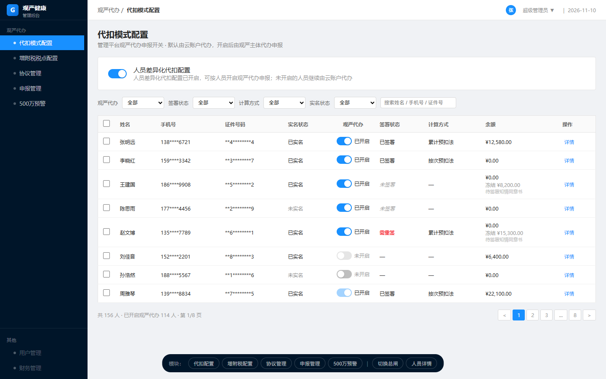

**页面目标**：管理员控制平台级观严代办申报的开启与关闭。

**页面结构**：总闸开关区域 + 功能说明。

**总闸区域**：

| 元素 | 说明 |
|------|------|
| 总闸 Toggle | 开启=人员差异化代扣配置开启（可按人员开启观严代办申报，未开启的人员继续由云账户代办）；关闭=全员统一走观严代办申报 |
| 状态文案 | 开启时：「人员差异化代扣配置已开启，可按人员开启观严代办申报；未开启的人员继续由云账户代办」<br>关闭时：「全员统一走观严代办申报」 |

**功能说明区域**：

| 内容 | 说明 |
|------|------|
| 开启说明 | 开启后，可按人员开启观严代办申报，未开启的人员继续由云账户代办；关闭后，全平台所有人员统一走观严代办申报 |
| 人员级配置 | 人员级别的观严代办开关，请在**用户管理**中进行配置 |

**核心逻辑**：
- 开启差异化代扣配置 → 可按人员开启观严代办申报，未开启的人员继续由云账户代办，人员级开关在用户管理中配置
- 关闭差异化代扣配置 → 全平台所有人员统一走观严代办申报，**已签署的授权不会取消**
- 再次开启差异化代扣配置 → 若用户协议未更新，无需重新签署

**交互**：
- 切换总闸（开启→关闭） → 弹出确认弹窗：提示"关闭后全平台所有人员将统一走观严代办申报，已签署的授权保留，再次开启时若协议未更新无需重新签署"，需输入"确认关闭"才能执行
- 切换总闸（关闭→开启） → 直接开启，无需确认
- 仅管理员可见此页面

**状态**：
| 总闸状态 | 页面表现 |
|---------|---------|
| 开启（差异化模式） | 总闸 Toggle=开，可按人员配置观严代办开关（用户管理中操作），未开启的人员继续由云账户代办 |
| 关闭（全员统一） | 总闸 Toggle=关，全平台所有人员统一走观严代办申报 |

---

#### 4.12 P2：用户管理

**页面目标**：管理平台用户列表及观严代办申报的人员级开关。

**入口**：管理端侧边栏 → 用户管理（独立菜单，位于"其他"分组下）。

**筛选条件**：

| 筛选项 | 选项 | 说明 |
|--------|------|------|
| 用户名 | 输入框 | — |
| 真实姓名 | 输入框 | — |
| 身份 | 全部 / 医生 / 护士 / 其他 | — |
| 观严代办 | 全部 / 已开启 / 未开启 | — |
| 联系电话 | 输入框 | — |
| 身份证号 | 输入框 | — |

**列表信息项**：

| 信息项 | 说明 |
|--------|------|
| 序号 | — |
| 用户名 | — |
| 真实姓名 | — |
| 身份 | 医生 / 护士 / 其他 |
| 领域 | 如"心血管内科" |
| 区域 | 如"四川省(成都市)" |
| 身份证号 | 脱敏 |
| 是否实名 | 是 / 否（Tag 样式） |
| 余额 | 账户余额 |
| 联系电话 | 脱敏 |
| 观严代办 | Toggle 开关（开启 / 关闭） |
| 操作 | 详情 / 银行卡 / 重置密码 |

**观严代办 Toggle 交互**：

- 开启 → 弹出确认弹窗：「确认开启观严代办申报？」→ 提示"开启后，该用户的收入将按观严代办方式代扣代缴"→ 确认后开启
- 关闭 → 弹出确认弹窗：「确认关闭观严代办申报？」→ 提示"关闭仅切换代扣路径，已签署的授权协议将保留。再次开启时，若协议版本未更新则无需重新签署"→ 确认后关闭
- **前置条件**：仅当「代扣配置管理 → 人员差异化代扣配置」总闸开启时，人员 Toggle 可操作；总闸关闭时全员统一走观严代办，Toggle 不可操作
- **余额锁**：有余额（余额 > 0）的用户，Toggle 不可操作（双向锁定，无法开启也无法关闭）；余额为 0 时方可切换。禁用时 hover 显示提示"该用户有余额，无法切换观严代办"

**前置条件说明**（页面底部提示框）：

> 💡 仅在「代扣配置管理 → 人员差异化代扣配置」总闸开启时，可按人员独立开启/关闭观严代办申报。总闸关闭时全员统一走观严代办，人员开关不可操作。**有余额的用户无法切换观严代办状态**（需余额为0方可操作）。

**权限**：仅管理员可操作。

---

#### 4.12.1 用户详情（4-Tab 侧滑面板）

点击用户列表的「详情」按钮，打开右侧滑面板，含4个Tab页。

**Tab 1：用户详情**

| 信息项 | 说明 |
|--------|------|
| 用户名 | — |
| 真实姓名 | — |
| 身份 | 医生 / 护士 / 其他 |
| 领域 | — |
| 区域 | — |
| 联系电话 | 脱敏 |
| 身份证号 | 脱敏 |
| 是否实名 | 已实名 / 未实名 |
| 代扣模式 | 观严代办 / 云账户代办（Tag 样式） |
| 注册时间 | — |
| 最后登录 | — |

账户信息：账户余额、可用余额、冻结金额、累计提现。

**Tab 2：就诊人管理**

用户关联的就诊人列表（姓名、关系、身份证号、性别、年龄、操作）。

**Tab 3：问诊信息**

问诊记录列表。

**Tab 4：观严代扣**

- **代办状态**：图标 + 标题（"观严代办已开启"/"观严代办未开启"）+ 右侧 Toggle 开关（余额锁规则同用户列表：余额 > 0 时 Toggle 禁用，hover 显示"该用户有余额，无法切换观严代办"）
- **冻结余额提示**（条件显示）：签署状态为"未签署"或"需重签"时，显示黄色警告"余额已冻结"
- **签署信息**：签署状态（已签署🟢/未签署🟡/需重签🔴）、申报方式、协议版本、签署时间、电子签名（查看链接）、协议文件（下载链接）
- **签署记录**：时间线列表，每条包含：
  - 时间（精确到秒）
  - 操作类型：首次签署 / 协议更新重签 / 取消授权
  - 申报方式 + 协议版本
  - 操作结果：操作成功 / 已取消
  - 签署记录提供「查看协议 ›」蓝色链接；取消授权记录用灰色圆点+灰色状态文字
- **授权说明**：关闭观严代办仅切换代扣路径，已签署的授权协议将保留。再次开启时，若协议版本未更新则无需重新签署。

---

#### 4.13 P3：总闸关闭确认弹窗

> 📷 视觉稿快照：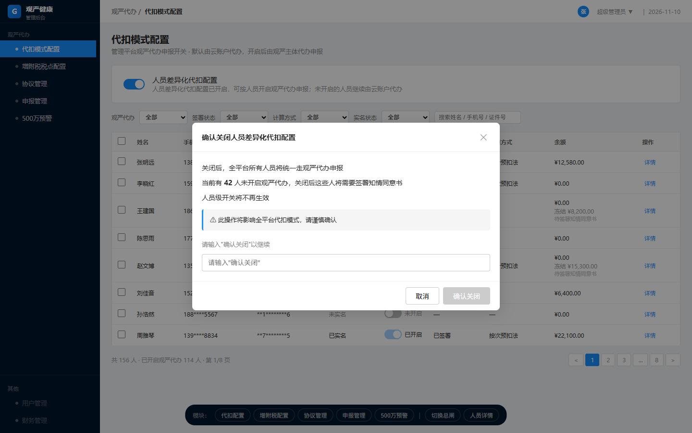

**触发**：管理员在 P1 切换总闸时弹出。

**前置校验**：系统先校验所有云账户代办用户的余额状态。如有余额>0的云账户用户，**禁止关闭总闸**，弹出阻断提示（非确认弹窗）：

| 元素 | 文案 |
|------|------|
| 标题 | 无法关闭人员差异化代扣配置 |
| 说明 | 当前有 X 名云账户代办用户仍有余额，需等待这些用户余额清零后方可关闭总闸 |
| 用户列表 | 姓名、手机号、余额（最多展示 20 人，超出显示"及其他 X 人"） |
| 按钮 | 我知道了 |

仅当所有云账户用户余额=0时，才弹出以下确认弹窗：

| 元素 | 文案 |
|------|------|
| 标题 | 确认关闭人员差异化代扣配置 |
| 影响说明 1 | 关闭后，全平台所有人员将统一走观严代办申报 |
| 影响说明 2 | 当前有 X 人走云账户代办，关闭后这些人将需要签署知情同意书 |
| 影响说明 3 | 人员级代扣配置将不再生效 |
| 警告 | ⚠ 此操作将影响全平台代扣模式，请谨慎确认 |
| 确认输入 | 请输入"确认关闭" |
| 按钮 | 取消 / 确认关闭（红色） |

**交互**：
- 输入框内容不等于"确认关闭"时，确认按钮禁用
- 确认后总闸状态切换，审计日志记录

---

#### 4.14 P4：批量开启观严代办弹窗

> 📷 视觉稿快照：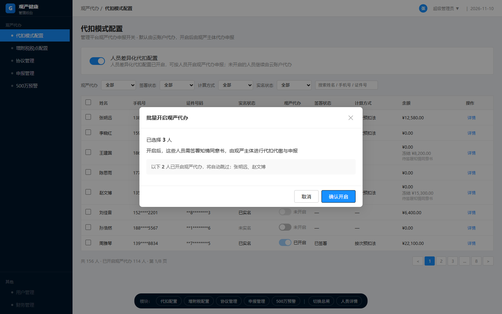

**触发**：在 P1 勾选多人后点击「批量开启观严代办」按钮。

**内容**：

| 元素 | 说明 |
|------|------|
| 标题 | 批量开启观严代办 |
| 已选人数 | 已选择 N 人 |
| 影响提示 | 开启后，这些人员需签署知情同意书，由观严主体进行代扣代缴与申报 |
| 跳过提示 | 如有已开启观严代办的人员，单独展示：「以下 X 人已开启观严代办，将自动跳过：姓名1、姓名2…」 |
| 按钮 | 取消 / 确认开启 |

---

#### 4.15 P5：增附税税点配置

> 📷 视觉稿快照：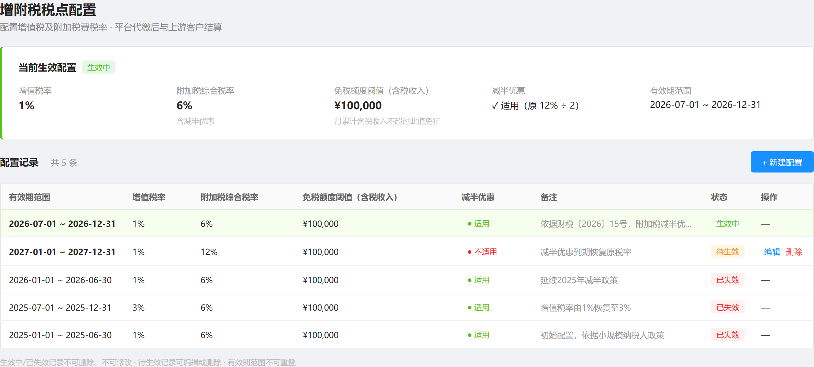

**页面目标**：管理员配置增值税率、附加税综合税率、免税额度阈值，满足不同时期税收政策调整的需求，无需修改代码即可适配新政策。

**页面结构**：单一配置页，展示当前生效配置 + 新建配置弹窗。

**当前生效配置展示**：

| 信息项 | 说明 |
|--------|------|
| 增值税率 | 当前生效的增值税征收率（如 1%） |
| 附加税综合税率 | 当前生效的综合税率（如 6%，已含减半优惠） |
| 免税额度阈值（含税收入） | 月累计含税收入不超过此值时增值税免征（如 100,000 元） |
| 减半优惠 | 当前状态：开/关 |
| 有效期范围 | 当前配置的生效起止日期（如 2026-01-01 ~ 2026-12-31） |

**历史版本列表**：按生效开始日期倒序展示历次配置变更记录，每条含：有效期范围（起止日期）、增值税率、附加税综合税率、免税额度阈值、减半优惠状态、备注。

**新建配置弹窗**：

| 元素 | 说明 |
|------|------|
| 增值税率（%） | 输入框，支持小数点后两位，范围 0.01% ~ 6% |
| 附加税综合税率（%） | 输入框，直接填写综合税率（如 12% 或减半后 6%），无需逐项填写城建/教育/地方教育附加 |
| 减半优惠 | Toggle 开关，开=适用减半；开启时系统自动将综合税率÷2展示 |
| 免税额度阈值（含税收入） | 金额输入框，单位：元，月累计含税收入不超过此值时增值税免征（默认 100,000） |
| 生效开始日期 | 日期选择器，至少为次日（不允许当天生效，需预留系统切换时间） |
| 生效结束日期 | 日期选择器，必须晚于生效开始日期，必须设置具体日期（不允许"长期"） |
| 说明/备注 | 文本输入框，最多 200 字，记录变更原因（如"依据财税〔202X〕X号"） |
| 影响提示 | 「新配置将于 YYYY-MM-DD ~ YYYY-MM-DD 期间对所有观严代扣用户生效」 |

**核心逻辑**：
- 配置按有效期范围自动生效/失效，系统在生效开始日 0 点自动应用新配置，在生效结束日次日 0 点自动失效
- 有效期结束日次日 0 点配置自动失效后，系统回退到上一条有效期最接近且仍在有效期内的配置；若无可用配置则增值税按 0% 处理，附加税按 0% 处理
- **无待生效配置警告**：当前生效配置到期后若无待生效配置接续，页面标红提示"当前生效配置到期后（YYYY-MM-DD）无待生效配置接续，届时将无法计算增附税，请及时新建配置"
- 生效结束日期必须设置具体日期，不允许设置为"长期"
- **有效期重叠处理（自动截断）**：若新配置的生效开始日期落在已有配置的有效期范围内，保存时系统自动将已有配置的生效结束日期截断为新配置开始日期的前一天，确保有效期不重叠。保存前弹窗提示用户确认截断影响。截断后已有配置在调整后的范围内仍正常生效，不影响历史入账的增附税计算
- 生效日之前的历史入账按旧配置计算，不受新配置影响
- 每次新建配置生成一条历史版本记录，历史版本不可删除、不可修改
- 同一时间段内不可有重叠的有效期范围
- 当前生效中的配置以高亮标识
- **免税额度阈值**：月度增值税免征判定使用此阈值，当用户当月含税结算收入累计 ≤ 阈值时，增值税免征；超过阈值时正常征收。增附税由平台代缴后从用户余额扣收，与个税同时预估、同时实扣。**此阈值同时作为连续劳务月度增附税起征点**

**权限**：仅管理员可操作，所有变更记录审计日志。

---

#### 4.16 P6：协议管理

> 📷 视觉稿快照：
> - 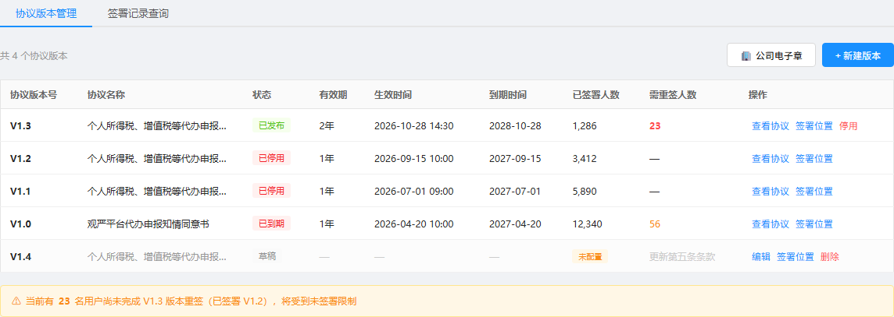
> - 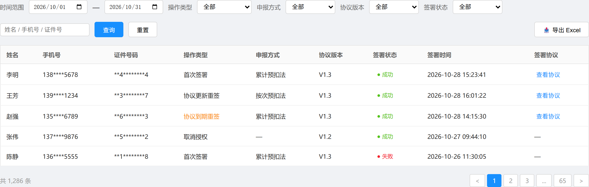

**页面目标**：管理知情同意书的版本生命周期与全平台签署记录查询。

##### P6-1：协议版本管理

**列表信息项**：

| 信息项 | 说明 |
|--------|------|
| 协议版本号 | 手工填写，如 V1.0 / V1.1 / V2.0 等 |
| 协议名称 | 如「个人所得税、增值税等代办申报知情同意书」 |
| 状态 | 草稿 / 已发布 / 已停用（同一时间只能有一个已发布版本） |
| 生效时间 | 发布时间，精确到秒 |
| 已签署人数 | 使用该版本签署的用户数 |
| 需重签人数 | 协议更新后尚未重签的用户数（仅已发布版本显示） |
| 备注 | 记录本次变更原因，如"初始版本""更新第五条条款" |
| 操作 | 编辑（草稿）/ 发布 / 查看协议内容 |

**新建版本流程**：

1. 点击「新建版本」→ 手工填写版本号（必填）
2. 填写协议名称 → 上传协议 PDF 文件
3. 配置签署位置（见下方「签署位置配置」）
4. 填写备注（选填，记录本次变更原因）
5. 保存为草稿 → 可反复编辑（草稿状态下版本号也可修改）
6. 点击「发布」→ 二次确认弹窗：
   - 标题：「确认发布协议版本 VX.X？」
   - 影响提示：「发布后，当前已发布版本将自动停用，所有已签署旧版本的用户将需要重新签署新版本。当前有 X 人需重签。」
   - 确认输入：请输入"确认发布"
   - 按钮：取消 / 确认发布
7. 确认发布 → 当前已发布版本自动变为「已停用」，新版本变为「已发布」，已签署用户状态变为「需重签」，触发重签流程（同 C8）

**签署位置配置**：

在协议正文中标记用户签名和公司盖章的放置位置，用户前端签署完成后系统自动将签名和印章合成到协议 PDF 上。

| 配置项 | 说明 |
|--------|------|
| 用户签名位 | 在协议正文预览中点击指定位置，标记「用户签名位」。支持拖拽调整位置。每个协议版本至少 1 个用户签名位 |
| 公司盖章位 | 在协议正文预览中点击指定位置，标记「公司盖章位」。支持拖拽调整位置。每个协议版本至少 1 个公司盖章位 |
| 公司电子章 | 上传公司电子印章图片（PNG 透明底），全局共用，不同版本共用同一枚印章。更换印章后，**仅影响新签署的协议**，已签署的协议保持原印章不变 |

**签署合成逻辑**：

1. 用户在前端完成手写签名（C2 Step 3）→ 提交签署
2. 系统将用户手写签名图片按「用户签名位」坐标合成到协议 PDF
3. 系统将公司电子章图片按「公司盖章位」坐标合成到同一份协议 PDF
4. 合成后的协议 PDF 作为该用户的签署凭证永久保存，不可篡改
5. 用户可在授权记录页（C7）查看/下载已签署的协议 PDF

**第三方电子签对接**：

引入具备 CA 数字证书认证的第三方电子签平台（如 e签宝、法大大等），为协议签署提供法律效力保障，满足税务局验收对电子签名合法性的要求。

| 对接项 | 说明 |
|--------|------|
| 签署方式 | 用户手写签名 → 系统调用第三方电子签平台 API → 平台生成 CA 认证的电子签名+电子印章 → 合成到协议 PDF |
| 公司电子章 | 在第三方平台注册企业账号并备案公司电子印章（需营业执照等资质认证），替代当前 PNG 图片上传方案 |
| 签名合法性 | 第三方平台提供数字证书（CA），确保签名不可伪造、不可篡改，具备法律效力 |
| 签署流程对接 | C2 Step3 手写签名提交后 → 系统将签名数据+协议 PDF 发送至第三方平台 → 第三方平台完成签署并返回已签署文件 → 系统保存 |
| 取消授权对接 | 用户取消授权时，需调用第三方平台 API 对已签署协议执行作废/撤销操作 |
| 签署记录同步 | 第三方平台的签署记录（签署时间、IP、证书信息等）需同步至管理端 P6-2 签署记录查询 |
| 管理端配置 | P6 协议管理新增「公司印章管理」入口：管理公司电子印章，支持上传/更换 PNG 印章图片（透明底），所有协议版本共用同一印章 |
| 验收材料 | 第三方平台提供的签署认证报告、数字证书信息可作为税局验收的佐证材料 |

**对接后的流程变化（相比自建方案）**：
- C2 Step3 签名提交后，需等待第三方平台返回签署结果（通常 <3 秒），超时需提示用户
- 管理端 P6 协议版本管理中，「公司电子章」从 PNG 上传改为从第三方平台选择已备案印章
- 已签署协议 PDF 由第三方平台生成和存证，系统存储副本用于展示和导出
- 签署记录自动包含第三方平台的认证信息（证书序列号、签署时间戳等）

> 📷 签署合成效果——协议PDF末页签名区（甲方手写签名 + 乙方红色圆形电子印章，签署时间一致）：
> - 

**签署位置预览**：
- 编辑协议时，正文预览页上以半透明占位框标注「用户签名位」和「公司盖章位」
- 占位框可拖拽移动、可调整大小
- 保存时将位置信息存入版本配置

**核心逻辑**：
- 同一时间仅一个版本为"已发布"状态
- 发布新版本时，旧版本自动变为"已停用"
- 唯一已发布版本不可停用（确保始终有可用协议），替换只能通过发布新版本实现
- 已停用版本不可恢复为已发布（需新建版本）
- 草稿版本不对外可见，不影响用户端
- 草稿状态下版本号可修改
- 协议正文支持富文本编辑，保存时生成版本快照，不可篡改
- 已签署的协议 PDF 保持签署时的签名/印章版本，不受后续印章更换或协议版本更新影响

**权限**：仅管理员可操作，所有变更记录审计日志。

##### P6-2：签署记录查询

**页面目标**：全平台维度查询用户签署流水，支持多维度筛选与导出。

**筛选条件**：

| 筛选项 | 选项 | 说明 |
|--------|------|------|
| 时间范围 | 起止日期 | 默认当月 |
| 操作类型 | 全部 / 首次签署 / 重新签署 / 取消授权 / 协议更新重签 | — |
| 申报方式 | 全部 / 连续劳务报酬（适用累计预扣法） / 一般劳务报酬（使用按次预扣法） | — |
| 协议版本 | 全部 / V1.0 / V1.1… | 动态读取已发布版本 |
| 签署状态 | 全部 / 成功 / 失败 | — |
| 关键词搜索 | 姓名 / 手机号 / 证件号 | 模糊搜索 |

**列表信息项**：

| 信息项 | 说明 |
|--------|------|
| 姓名 | — |
| 手机号 | — |
| 证件号码 | 脱敏显示 |
| 操作类型 | 首次签署 / 重新签署 / 取消授权 / 协议更新重签 |
| 申报方式 | 连续劳务报酬（适用累计预扣法） / 一般劳务报酬（使用按次预扣法）（取消授权时显示"—"） |
| 协议版本 | V1.0 / V1.1 等 |
| 签署状态 | 成功（绿）/ 失败（红） |
| 操作时间 | 精确到秒 |
| 失败原因 | 仅失败时显示 |
| 签署协议 | 「查看协议」链接（签署成功时），点击弹窗预览该用户的已签署协议 PDF（含签名+电子章），无需进入详情页 |

**操作**：
- 导出：支持按当前筛选条件导出 Excel
- 点击行 → 可查看该用户的用户详情面板（P2 4-Tab 侧滑）

**分页**：每页 20 条，按操作时间倒序排列。

---

#### 4.17 P7：申报管理

> 📷 视觉稿快照：
> - 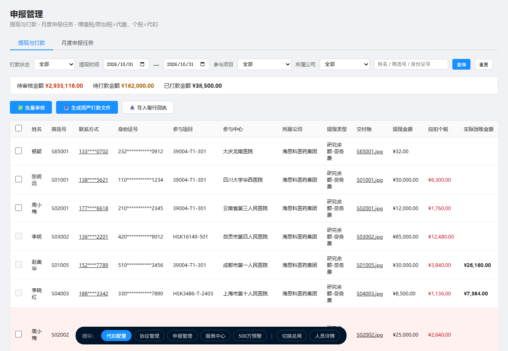
> - 

**页面目标**：管理观严代办用户的提现审核与打款执行，以及月度税务申报任务，确保平台按时完成代扣代缴申报义务。

##### P7-2：月度申报任务

**任务自动生成**：每月 1 日系统自动生成上月申报任务，每条任务对应一个申报月份。

**列表信息项**：

| 信息项 | 说明 |
|--------|------|
| 申报月份 | 如「2026年10月」 |
| 申报状态 | 待申报 / 申报中 / 已完成 / 已逾期 |
| 个税应申报总额 | 当月所有观严代扣用户的个税代扣合计 |
| 增值税应申报总额 | 当月平台代缴的增值税合计（平台与上游客户结算） |
| 附加税应申报总额 | 当月平台代缴的附加税合计（平台与上游客户结算） |
| 涉及人数 | 当月有扣税记录的观严代扣用户数 |
| 截止日期 | 税务局规定申报截止日（通常为次月 15 日，遇节假日顺延） |
| 操作 | 查看明细 / 提交申报 / 下载申报表 |

**申报状态流转**：

> 待申报 → 申报中 → 已完成 ；超截止日期未完成 → 已逾期

**查看明细**：点击后展示当月所有用户的扣税汇总列表：

| 信息项 | 说明 |
|--------|------|
| 姓名 | — |
| 证件号码 | 脱敏 |
| 计算方式 | 连续劳务报酬（适用累计预扣法） / 一般劳务报酬（使用按次预扣法） |
| 当月入账笔数 | — |
| 含税结算收入合计 | 当月该用户含税结算收入合计 |
| 累计收入 | 截至当月末（连续劳务报酬（适用累计预扣法）） |
| 当月扣个税 | 当月该用户个税代扣金额 |
| 当月扣增值税 | 当月该用户对应的增值税代缴金额（平台代缴，与上游客户结算） |
| 当月扣附加税 | 当月该用户对应的附加税代缴金额（平台代缴，与上游客户结算） |
| 税费合计 | 个税 + 增值税 + 附加税 |
| 入账后余额 | — |
| 操作 | 查看逐笔明细 |

**逐笔明细**：点击某用户的「查看逐笔明细」，展示该用户当月每笔入账的完整税额计算过程：

**① 基础信息行**（每笔一条）：

| 信息项 | 说明 |
|--------|------|
| 入账日期 | YYYY-MM-DD HH:mm |
| 含税结算收入 | 本笔含税金额 |
| 不含税收入 | = 含税收入 / (1 + 增值税率) |

**② 增附税计算**：

| 信息项 | 说明 |
|--------|------|
| 增值税 | = 不含税收入 × 增值税率 |
| 附加税 | = 增值税 × 附加税综合税率（含减半） |
| 增附税合计 | 增值税 + 附加税 |
| 免税判定 | 「免征」（月累计含税收入 ≤ 免税额度阈值）/ 「征收」 |
| 平台代缴增附税 | 免征时为 0；征收时为增附税合计（平台代缴，从用户余额扣收） |

**③ 个税计算**：

**连续劳务报酬（适用累计预扣法）**：

| 信息项 | 说明 |
|--------|------|
| 累计收入 | 截至本笔（不含增值税） |
| 累计费用 | = 累计收入 × 20% |
| 累计减除费用 | = 5,000 × 连续月份数 |
| 其他扣除 | 默认 0 |
| 累计应纳税所得额 | = 累计收入 − 累计费用 − 累计减除费用 − 其他扣除 |
| 适用预扣率 / 速算扣除数 | 根据应纳税所得额查表 |
| 累计应预扣税额 | = 应纳税所得额 × 预扣率 − 速算扣除数 |
| 累计已预扣 | 截至上笔 |
| 本期应预扣个税 | = 累计应预扣 − 累计已预扣 |
| 连续月份数 | — |

**一般劳务报酬（使用按次预扣法）**：

| 信息项 | 说明 |
|--------|------|
| 单笔收入 | = 不含税收入 |
| 减除费用 | ≤4,000 减 800；>4,000 减 20% |
| 应纳税所得额 | = 单笔收入 − 减除费用 |
| 适用预扣率 / 速算扣除数 | 根据应纳税所得额查表 |
| 本笔应预扣个税 | = 应纳税所得额 × 预扣率 − 速算扣除数 |

**④ 入账结果**：

| 信息项 | 说明 |
|--------|------|
| 预估扣个税 | 本期/本笔应预扣个税（入账时展示预估） |
| 打款扣个税 | 审核通过后按当时累计数据计算、打款时实际代扣的个税 |
| 平台代缴增附税 | 免征=0，征收=增附税合计（从用户余额扣收） |
| 实际到账金额 | = 含税收入 − 打款扣个税 |

逐笔明细支持导出 Excel（含完整计算过程）。

**下载申报表**：按税务局要求的格式生成申报表文件（Excel / PDF），包含：
- 个人所得税代扣代缴报告表
- 增值税纳税申报表（小规模纳税人适用）
- 附加税申报表

**逾期提醒**：
- 截止日前 3 天：系统内消息提醒管理员
- 截止日当天：页面顶部红色横幅「2026年10月申报将于今日截止，请尽快完成」
- 逾期后：状态变为"已逾期"，红色标记

**权限**：仅管理员可操作。所有申报提交记录审计日志。

##### P7-1：提现与打款

> 📷 视觉稿快照：

**页面目标**：管理观严代办用户的提现记录与打款执行，支持批量审核、一键生成打款文件包（银行+税局）、导入银行回执更新到账状态。

**打款状态流转**：

```
待审核 →（批量审核）→ 待打款 →（生成观严打款文件）→ 打款中 →（导入银行回执）→ 已到账
                                                                    ↓
                                                               打款失败 →（重新打款）→ 待打款
```

| 状态 | 说明 |
|------|------|
| 待审核 | 用户提现后的初始状态，等待管理员审核 |
| 待打款 | 审核通过，等待生成打款文件并执行打款 |
| 打款中 | 已生成打款文件，等待银行处理 |
| 已到账 | 银行回执确认到账 |
| 打款失败 | 银行打款失败，可重新打款（回退到待打款） |

**工具栏（3个操作按钮）**：

| 按钮 | 说明 |
|------|------|
| ✅ 批量审核 | 勾选"待审核"记录 → 审核通过 → 状态变为"待打款"。仅"待审核"状态的记录可被审核 |
| 📤 生成观严打款文件 | 勾选"待打款"记录或导出全部"待打款"记录 → 一键生成5个文件（见下方"打款文件包"）。**前置条件：P9 公司打款账号已配置，否则按钮禁用** |
| 📥 导入银行回执 | 上传银行回执文件 → 系统按"对账编号"（即提现编号）匹配记录 → 自动更新打款状态（已到账/打款失败） |

**打款文件包（5合1）**：

点击「生成观严打款文件」后，系统根据勾选或全部待打款记录，一次性生成以下5个文件：

**① 银行批量转账文件**（中信银行 payTrans 格式）：

| 字段 | 取值 |
|------|------|
| 付款方式 | 固定"跨行转账" |
| 付款账号 | P9 配置的公司付款账号 |
| 币种 | 人民币 |
| 收款账号 | 用户银行卡号 |
| 收款方名称 | 用户姓名 |
| 收款方账户编号 | 空 |
| 支付联行号 | 空 |
| 开户网点名称 | 用户所属行 |
| 支付金额 | 实际打款金额（提现金额 − 应扣个税 − 应扣增附税） |
| 附言 | 提现编号 + "-劳务报酬"（如 TX20261015001-劳务报酬） |
| 备注 | 空 |
| 对账编号 | 提现编号 |

**② 人员信息采集文件**（税局扣缴客户端导入格式）：

| 字段 | 取值 |
|------|------|
| \*姓名 | 用户姓名 |
| \*证件类型 | 居民身份证 |
| \*证件号码 | 用户身份证号 |
| \*国籍 | 中国 |
| \*性别 | 从身份证号自动提取 |
| \*出生日期 | 从身份证号自动提取 |
| \*任职受雇从业类型 | 固定"平台内从业人员" |
| 手机号码 | 用户手机号 |
| 任职受雇从业日期 | 用户签署日期 |
| 是否扣除减除费用 | 空 |
| 残疾/烈属/孤老 | 空 |

**③ 连续劳务报酬——适用累计预扣法文件**（税局扣缴客户端导入格式）：

仅导出申报方式为"连续劳务报酬（适用累计预扣法）"的记录，每笔提现一条：

| 字段 | 取值 |
|------|------|
| 工号 | 用户工号/编号 |
| \*姓名 | 用户姓名 |
| \*证件类型 | 居民身份证 |
| \*证件号码 | 用户身份证号 |
| \*所得项目 | 固定"其他连续劳务报酬" |
| 本期收入 | 提现金额 |
| 本期免税收入 | 空 |
| 其他 | 按"其他"字段内容填入 |

**④ 一般劳务报酬——不适用累计预扣法文件**（税局扣缴客户端导入格式）：

仅导出申报方式为"一般劳务报酬（使用按次预扣法）"的记录，每笔提现一条：

| 字段 | 取值 |
|------|------|
| 工号 | 用户工号/编号 |
| \*姓名 | 用户姓名 |
| \*证件类型 | 居民身份证 |
| \*证件号码 | 用户身份证号 |
| \*所得项目 | 固定"一般劳务报酬所得" |
| \*收入 | 提现金额 |
| 免税收入 | 空 |
| 其他 | 按"其他"字段内容填入 |

**⑤ 提现记录文件**（Excel，字段与列表一致）：

每条记录包含列表所有列信息：姓名、筛选号、联系方式、身份证号、参与项目、参与中心、所属公司、提现类型、交付物、提现金额、应扣个税、实际到账金额、打款状态、账户、所属行、提现时间、到账时间。

**筛选条件**：

| 筛选项 | 选项 | 说明 |
|--------|------|------|
| 打款状态 | 全部 / 待审核 / 待打款 / 打款中 / 已到账 / 打款失败 | — |
| 提现时间 | 起止日期 | 默认当月 |
| 参与项目 | 全部 / 项目列表 | — |
| 所属公司 | 全部 / 公司列表 | — |
| 关键词搜索 | 姓名 / 筛选号 / 身份证号 | 模糊搜索 |

**列表信息项**：

| 信息项 | 说明 |
|--------|------|
| 勾选框 | 支持多选，用于批量审核、生成打款文件 |
| 姓名 | — |
| 筛选号 | — |
| 联系方式 | 可点击链接样式 |
| 身份证号 | — |
| 参与项目 | — |
| 参与中心 | — |
| 所属公司 | — |
| 提现类型 | — |
| 交付物 | 可点击链接样式 |
| 提现金额 | — |
| 应扣个税 | 审核通过后计算的实扣个税 |
| 实际到账金额 | = 提现金额 − 应扣个税 − 应扣增附税；未到账时为空 |
| 计算方式 | 连续劳务报酬（适用累计预扣法） / 一般劳务报酬（使用按次预扣法） |
| 打款状态 | 待审核 / 待打款 / 打款中 / 已到账 / 打款失败 |
| 账户 | 银行卡尾号脱敏 |
| 所属行 | — |
| 提现时间 | YYYY-MM-DD HH:mm |
| 到账时间 | 仅已到账状态有值 |
| 操作 | 查看详情 / 重新打款（仅打款失败状态） |

**汇总统计条**（列表上方）：

| 统计项 | 颜色 | 说明 |
|--------|------|------|
| 待审核金额 | 红色 | 所有"待审核"记录的提现金额合计 |
| 待打款金额 | 橙色 | 所有"待打款"记录的提现金额合计 |
| 已打款金额 | 黑色 | 所有"打款中"+"已到账"记录的提现金额合计 |

**导入银行回执**：

1. 点击「导入银行回执」→ 上传银行回执文件（Excel）
2. 系统按"对账编号"字段匹配提现记录
3. 匹配成功 → 根据回执内容更新打款状态（已到账 / 打款失败）
4. 匹配失败 → 列出未匹配的对账编号，供人工确认
5. 打款失败的记录，可点击「重新打款」回退到"待打款"状态

**核心逻辑**：
- 仅"待审核"状态的记录可被批量审核，审核后状态变为"待打款"
- "生成观严打款文件"仅对"待打款"状态的记录生效，生成后状态变为"打款中"
- 人员信息文件中，性别和出生日期从身份证号自动提取（18位身份证：第17位奇=男/偶=女，第7-14位为出生日期）
- 人员信息文件中，"任职受雇从业类型"固定为"平台内从业人员"
- 劳务报酬文件中，"本期收入"/"收入"取提现金额（含税），按用户申报方式分别导出到③④两个文件
- 银行转账文件中，附言格式为"提现编号-劳务报酬"，对账编号为提现编号（用于回执匹配）
- P9 公司打款账号未配置时，「生成观严打款文件」按钮禁用，Tooltip 提示"请先配置公司打款账号"

**分页**：每页 20 条，按提现时间倒序排列。

**权限**：仅管理员可操作，所有审核和打款操作记录审计日志。

---

#### 4.18 P8：500万预警用户列表

> 📷 视觉稿快照：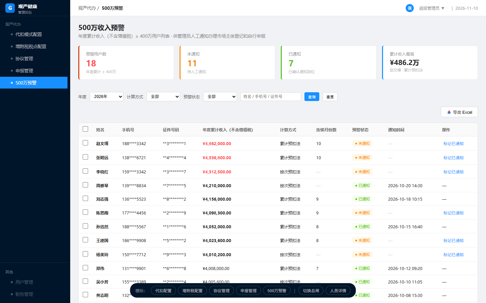

**页面目标**：统计年度累计收入接近500万的用户，供管理员人工通知，引导其办理市场主体登记和自行申报。

**入口**：申报管理或独立菜单入口。

**筛选条件**：

| 筛选项 | 选项 | 说明 |
|--------|------|------|
| 年度 | 当前年度 / 历史年度 | 默认当前年度 |
| 计算方式 | 全部 / 连续劳务报酬（适用累计预扣法） / 一般劳务报酬（使用按次预扣法） | — |
| 关键词搜索 | 姓名 / 手机号 / 证件号 | 模糊搜索 |

**列表信息项**：

| 信息项 | 说明 |
|--------|------|
| 姓名 | — |
| 手机号 | — |
| 证件号码 | 脱敏显示 |
| 年度累计收入（不含增值税） | 截至当前月份的累计值 |
| 计算方式 | 连续劳务报酬（适用累计预扣法） / 一般劳务报酬（使用按次预扣法） |
| 连续月份数 | 仅连续劳务报酬（适用累计预扣法）显示 |
| 预警状态 | 未通知 / 已通知 |

**核心逻辑**：
- 仅统计"人员开关=开"且"已签署"的用户
- 年度累计收入（不含增值税）≥ 400万的用户进入列表
- 列表默认按累计收入降序排列
- 管理员可手动标记「已通知」，标记后预警状态变为"已通知"

**操作**：
- 导出：支持按当前筛选条件导出 Excel
- 手动标记「已通知」

**分页**：每页 20 条。

---

#### 4.19 P9：公司打款账号管理

**页面目标**：配置公司付款银行账号信息，用于生成银行批量转账文件（P7-3 打款文件包中的银行转账文件）。

**入口**：管理端 → 代扣配置管理 → 公司打款账号管理 Tab。

**配置模式**：单账号。系统仅支持配置一个公司付款账号。

**配置信息项**：

| 信息项 | 说明 |
|--------|------|
| 公司名称 | 必填，付款主体名称（如"上海观严企业管理咨询有限公司"） |
| 付款账号 | 必填，公司付款银行卡号 |
| 银行名称 | 必填，开户银行名称（如"中信银行"） |
| 开户行 | 必填，具体开户网点（如"中信银行上海分行"） |

**交互**：
- 页面直接展示4个字段表单，已有配置时自动填入当前值
- 点击「保存」保存配置，即时生效，影响后续生成的银行转账文件中的付款方信息
- 4个字段均为必填，未填全时「保存」按钮禁用

**前置影响**：
- **P9 未配置时**，P7-3 提现与打款页的「生成观严打款文件」按钮禁用，Tooltip 提示"请先配置公司打款账号"
- **P9 已配置时**，银行转账文件中的"付款账号"自动取此配置值

**权限**：仅管理员可操作，配置变更记录审计日志。

---

#### 4.20 P10：报表中心

**页面目标**：提供个税、增附税的计算明细报表和上游客户结算数据，供管理员核对与导出。

**入口**：管理端侧边栏 → 报表中心（独立菜单，位于申报管理下方）。

##### P10-1：个税代扣明细表

按提现记录逐笔展示个税计算明细，含完整个税累计计算过程。提现记录审核通过后生成。

**筛选条件**：

| 筛选项 | 选项 | 说明 |
|--------|------|------|
| 时间范围 | 起止日期 | 默认当月 |
| 计算方式 | 全部 / 连续劳务报酬（适用累计预扣法） / 一般劳务报酬（使用按次预扣法） | — |
| 关键词搜索 | 姓名 / 证件号 | 模糊搜索 |

**列表信息项**：

| 信息项 | 说明 |
|--------|------|
| 提现编号 | — |
| 姓名 | — |
| 证件号码 | 脱敏 |
| 计算方式 | 连续劳务报酬（适用累计预扣法） / 一般劳务报酬（使用按次预扣法） |
| 提现金额 | — |
| 提现时累计收入 | 截至提现时（连续劳务报酬（适用累计预扣法）） |
| 累计费用(20%) | 连续劳务报酬（适用累计预扣法）：= 累计收入 × 20%；一般劳务报酬（使用按次预扣法）：= 单笔收入 × 20% |
| 累计减除费用 | 连续劳务报酬（适用累计预扣法）：= 5,000 × 连续月份数；一般劳务报酬（使用按次预扣法）：显示"—" |
| 累计应纳税所得额 | = 累计收入 − 累计费用 − 累计减除费用 − 其他扣除 |
| 提现时连续月份数 | 连续劳务报酬（适用累计预扣法）专用；一般劳务报酬（使用按次预扣法）：显示"—" |
| 适用预扣率 | — |
| 速算扣除数 | 连续劳务报酬（适用累计预扣法）：对应预扣率档位；一般劳务报酬（使用按次预扣法）：0 |
| 累计应预扣税额 | = 累计应纳税所得额 × 预扣率 − 速算扣除数 |
| 累计已预扣 | 截至本笔之前已预扣的个税总额 |
| 应扣个税 | = 累计应预扣税额 − 累计已预扣 |
| 实际到账 | = 提现金额 − 应扣个税 − 应扣增附税（如有） |
| 提现时间 | YYYY-MM-DD HH:mm |
| 打款时间 | — |

**操作**：导出 Excel。

##### P10-2：增值税计算明细表

按入账记录逐笔展示增值税、附加税计算明细与免税判定。

**筛选条件**：

| 筛选项 | 选项 | 说明 |
|--------|------|------|
| 时间范围 | 起止日期 | 默认当月 |
| 免税判定 | 全部 / 免征 / 征收 | — |
| 关键词搜索 | 姓名 / 证件号 | 模糊搜索 |

**列表信息项**：

| 信息项 | 说明 |
|--------|------|
| 入账编号 | — |
| 姓名 | — |
| 证件号码 | 脱敏 |
| 入账日期 | YYYY-MM-DD |
| 含税结算收入 | — |
| 不含税收入 | = 含税收入 / (1 + 增值税率) |
| 增值税率 | 当前生效税率 |
| 增值税 | — |
| 附加税综合税率 | 当前生效税率 |
| 附加税 | — |
| 增附税合计 | 增值税 + 附加税 |
| 月累计含税收入 | 截至本笔 |
| 免税额度阈值 | P5 配置值 |
| 免税判定 | 免征 / 征收 |
| 平台代缴增附税 | 免征=0，征收=增附税合计（从用户余额扣收） |

**操作**：导出 Excel。

##### P10-3：上游客户结算表

按月汇总增附税代缴数据，用于与上游客户结算对账。

**筛选条件**：

| 筛选项 | 选项 | 说明 |
|--------|------|------|
| 月份 | 月份选择 | 默认当月 |

**列表信息项**：

| 信息项 | 说明 |
|--------|------|
| 月份 | 如「2026年10月」 |
| 观严代扣用户数 | 当月有入账的观严代扣用户数 |
| 含税结算收入总额 | 当月所有观严代扣用户含税收入合计 |
| 不含税收入总额 | — |
| 增值税代缴总额 | 当月征收的增值税合计 |
| 附加税代缴总额 | 当月征收的附加税合计 |
| 增附税代缴合计 | 增值税 + 附加税 |
| 增值税免征总额 | 当月免征的增值税合计 |
| 附加税免征总额 | 当月免征的附加税合计 |
| 免征增附税合计 | — |

**操作**：导出 Excel。

**权限**：仅管理员可操作。

---

## 五、个税计算逻辑

> 法规依据：国家税务总局公告 2025 年第 16 号

### 5.1 计算原则

- **入账时全额进余额**：费用计入余额时，全额入账，同时展示预估个税和预估增附税金额（仅供参考）
- **审核通过后计算实扣个税和增附税**：用户提现审核通过后，按当时累计数据计算实扣个税和增附税，写入提现记录并锁定
- **打款时执行代扣**：后台批量打款时，按提现记录中的税额执行代扣代缴，不重新计算
- **增附税从用户扣收**：增值税及附加税的纳税义务人为用户本人，平台代缴后从用户余额扣收，与个税同时预估、同时实扣
- **用户选择申报方式**：签署知情同意书时，用户选择「连续劳务报酬（适用累计预扣法）」或「一般劳务报酬（使用按次预扣法）」
- **单一方式生效**：同一用户同一时期只能使用一种计算方式；取消授权后重新授权时可更改
- **本平台口径**：所有累计数据均按"本平台"（观严平台）收入计算，不含云账户、其他平台

### 5.2 触发时机

| 触发场景 | 说明 |
|---------|------|
| 余额到账时 | 全额进余额，系统预估应扣个税和增附税金额展示给用户（仅供参考） |
| 用户提现时 | **展示预估个税和增附税**：按当前累计数据估算应扣个税和增附税，写入提现申请，仅供参考 |
| 审核通过后 | **计算实扣个税和增附税**：按审核通过时点累计数据计算实扣个税和增附税，写入提现记录，锁定税额 |
| 后台批量打款时 | **执行代扣代缴**：按提现记录中的锁定税额（个税+增附税）从用户余额扣除，剩余金额打款给用户 |
| 签署后释放冻结 | 未签署时冻结的金额，签署后释放到可用余额（个税在审核通过后计算、打款时代扣） |

> **跨月说明**：用户提现与审核通过可能跨月。实扣个税以审核通过时点的累计数据计算并锁定，打款时按锁定税额执行，不受打款月累计数据变化影响。

### 5.3 连续劳务报酬（适用累计预扣法）

适用于在本平台持续获得收入的用户。按全年累计收入计算预扣税额，月收入较低时税负较轻。

**计算公式**：

```
本期应预扣预缴税额 = (累计收入 − 累计费用 − 累计免税收入 − 累计减除费用 − 累计依法确定的其他扣除) × 预扣率 − 速算扣除数 − 累计减免税额 − 累计已预扣预缴税额
```

**各字段定义**：

| 项目 | 取值口径 | 说明 |
|------|---------|------|
| 累计收入 | 当年截至本月，该人在本平台取得的劳务报酬税前合计（不含增值税、不含经营所得） | 自开启观严代办模式起计算 |
| 累计费用 | 累计收入 × 20% | 统一比例，无 4,000 元分档 |
| 累计免税收入 | 默认 0 | 个税法第四条免征项，普通劳动者通常为 0 |
| 累计减除费用 | 5,000 元/月 × 截至本月在本平台连续取得劳务报酬的月份数 | 自开启观严代办后有收入的连续月份；中断重新开始 |
| 累计依法确定的其他扣除 | 默认 0 | 依法可扣项，预留 |
| 累计减免税额 | 默认 0 | 残疾/孤老/烈属减征等，通常为 0 |
| 累计已预扣预缴税额 | 本年本平台已扣个税累计 | 中断重置时同步清零 |

**预扣率表**（七级超额累进）：

| 级数 | 累计预扣预缴应纳税所得额 | 预扣率 | 速算扣除数 |
|------|--------------------------|--------|-----------|
| 1 | 不超过 36,000 元 | 3% | 0 |
| 2 | 超过 36,000 元至 144,000 元 | 10% | 2,520 |
| 3 | 超过 144,000 元至 300,000 元 | 20% | 16,920 |
| 4 | 超过 300,000 元至 420,000 元 | 25% | 31,920 |
| 5 | 超过 420,000 元至 660,000 元 | 30% | 52,920 |
| 6 | 超过 660,000 元至 960,000 元 | 35% | 85,920 |
| 7 | 超过 960,000 元 | 45% | 181,920 |

**计算示例**：

用户选择连续劳务报酬（适用累计预扣法），1月首次取得收入 10,000 元（不含增值税）：
- 累计收入 = 10,000；累计费用 = 2,000；累计减除费用 = 5,000
- 应纳税所得额 = 10,000 − 2,000 − 5,000 = 3,000；预扣率 3%
- 本期应扣税额 = 3,000 × 3% = 90 元

2月取得收入 15,000 元：
- 累计收入 = 25,000；累计费用 = 5,000；累计减除费用 = 10,000
- 应纳税所得额 = 10,000；预扣率 3%
- 本期应扣税额 = 10,000 × 3% − 90 = 210 元

### 5.4 一般劳务报酬（使用按次预扣法）

适用于偶尔获得收入的用户。每笔收入独立计算税额，不参与跨笔累计。

**计算公式**：

```
应纳税所得额 = 每次收入（不含增值税）− 减除费用
应预扣预缴税额 = 应纳税所得额 × 预扣率 − 速算扣除数
```

**减除费用规则**：

| 每次收入 | 减除费用 |
|---------|---------|
| ≤ 4,000 元 | 800 元（定额） |
| ＞ 4,000 元 | 收入 × 20%（定率） |

**预扣率表**（三级）：

| 级数 | 应纳税所得额 | 预扣率 | 速算扣除数 |
|------|-------------|--------|-----------|
| 1 | 不超过 20,000 元 | 20% | 0 元 |
| 2 | 超过 20,000 元至 50,000 元 | 30% | 2,000 元 |
| 3 | 超过 50,000 元 | 40% | 7,000 元 |

**注意**：每笔独立扣、独立申报，不参与下笔计算。

### 5.5 连续判定与中断重置（连续劳务报酬（适用累计预扣法）专用）

**连续月份数计算规则**：

| 规则 | 说明 |
|------|------|
| 连续月份数 | 从当年首次取得收入起逐自然月 +1；同月多笔不增月份数 |
| 中断判定 | 某自然月内无任何入账 = 中断 |
| 中断粒度 | 按自然月为最小粒度 |
| 跨年处理 | 每年 1 月 1 日 0 点清零，新年度从首笔重算 |

> 依据：国家税务总局公告 2025 年第 16 号第一条第（一）项及其官方解读。

**中断触发后的重置清单**（5 项全部清零，同一事务内完成）：

| # | 项目 | 重置为 | 说明 |
|---|------|--------|------|
| ① | 累计收入 | 0 | 重启当月从本次收入重新累加 |
| ② | 累计费用 | 0 | 随累计收入重算 |
| ③ | 累计减除费用 | 0 | 重启当月按 5,000 × 1 = 5,000 计 |
| ④ | 累计已预扣预缴税额 | 0 | **不清零会算出负税额**（最易漏！） |
| ⑤ | 预扣率适用档位 | 回到第 1 级 | 重新判断 |

**重要说明**：
- 清零的是「本平台当年累计链滚动值」，已缴税已入国库不退
- 年终汇算时多平台合并统一多退少补
- 重置与重算必须保证原子性

### 5.6 取消授权与重新授权对累计数据的影响

| 场景 | 累计数据处理 | 计算方式 |
|------|------------|---------|
| 取消授权 | 累计数据保留（不清零） | — |
| 重新授权（同方式） | 接续计算（使用保留的累计数据） | 保持原方式 |
| 重新授权（换方式） | 累计法已扣的税正常代扣代缴；若年度内再使用连续劳务报酬（适用累计预扣法），之前按累计法获得的收入算到本次的累计中 | 可重新选择 |

### 5.7 增值税及附加税计算逻辑

增值税及附加税的纳税义务人为用户本人（依据知情同意书4.5条）。平台代办申报并代缴后，从用户余额扣收，与个税同时预估、同时实扣。

#### 5.7.1 增值税计算

```
不含税收入 = 含税结算收入 / (1 + 增值税率)
增值税 = 不含税收入 × 增值税率
```

> 增值税征收率为 3%，2026年1月1日至2027年12月31日期间减按 1%（依据财政部 税务总局公告2026年第10号）。

#### 5.7.2 附加税计算

```
附加税 = 增值税 × 附加税综合税率
```

附加税综合税率包含：城市维护建设税（7%/5%/1%）+ 教育费附加（3%）+ 地方教育附加（2%）。2023年1月1日至2027年12月31日期间，小规模纳税人可减半征收。管理端P5配置时直接填写综合税率（如12%或减半后6%）。

#### 5.7.3 一般劳务增附税起征点（一般劳务报酬（使用按次预扣法）适用）

| 单次（日）含税销售额 | 增值税 | 附加税 |
|----------------------|--------|--------|
| ≤ 1,000 元 | 免征 | 免征（随增值税） |
| > 1,000 元 | 全额计征 | 以增值税为计费依据，全额计征 |

> 依据：国家税务总局公告2026年第4号，一般劳务按次（日）起征点为1,000元。超过起征点时，就单次（日）销售额**全额**计算缴纳增值税（不是仅超1,000元的部分）。

#### 5.7.4 连续劳务增附税起征点（连续劳务报酬（适用累计预扣法）适用）

起征点即管理端P5增附税税点配置中的「免税额度阈值」（当前默认100,000元），非固定值。

| 月累计含税销售额 | 增值税 | 附加税 |
|-----------------|--------|--------|
| < 免税额度阈值 | 免征 | 免征（随增值税） |
| ≥ 免税额度阈值 | 全额计征 | 以增值税为计费依据，全额计征 |

> 依据：国家税务总局公告2026年第4号，连续劳务以一个月为一个计税期间，月销售额未超过免税额度阈值时免征。达到或超过阈值时，就当月**全部销售额**全额计算缴纳增值税（不是仅超额部分）。

#### 5.7.5 连续劳务起征点的时效性

连续劳务的入账是逐笔发生的，阈值需月末才能最终判定。以下以免税额度阈值=10万元为例：

```
示例：11月
11/01  入账 ¥30,000  累计 ¥30,000  < 10万 → 免征
11/15  入账 ¥40,000  累计 ¥70,000  < 10万 → 免征
11/28  入账 ¥50,000  累计 ¥120,000 ≥ 10万 → 整月全额计征！
```

第三笔入账触发阈值后，前两笔也需要补征增值税。前几笔入账时用户余额中没有预留增附税。

**入账时预估展示**：

> 起征点从管理端P5增附税税点配置中获取，非固定值。以下以免税额度阈值=10万元为例。

连续劳务报酬（适用累计预扣法）下，增附税预估按**两个条件**独立判定，任一满足即展示：

| 条件 | 判定 | 入账时展示 |
|------|------|-----------|
| ① 单笔起征 | 单笔到账含税金额 > 1,000元 | 预估个税 + 该笔预估增附税 |
| ② 月累计起征 | 月累计含税收入 ≥ 免税额度阈值（如 ≥ 10万） | 预估个税 + 预估增附税（按当月全部累计含税收入计算） |

- 两个条件均不满足时：仅展示预估个税，增附税显示"免征"
- 两个条件同时满足时：按月累计起征计算（含当月全部累计含税收入，非仅超额部分）

```
示例：11月（阈值=10万）
11/01  入账 ¥30,000  累计 ¥30,000  单笔>1000✓ → 显示该笔增附税；月累计<10万 → 免征
11/15  入账 ¥40,000  累计 ¥70,000  单笔>1000✓ → 显示该笔增附税；月累计<10万 → 免征
11/28  入账 ¥50,000  累计 ¥120,000 单笔>1000✓ → 显示该笔增附税；月累计≥10万 → 按整月全额计征
```

**余额不足时的处理（代垫机制）**：

月累计跨过阈值后，需扣当月全额增附税，但前几笔入账时未预留，用户余额可能不足。公司代垫差额部分，后续与上游客户结算，不从用户余额追缴。

#### 5.7.6 增值税与个税基数的关系

个税计算中的"收入"均为**不含增值税**金额。

```
不含税收入 = 平台含税结算收入 / (1 + 增值税率)
```

| 项目 | 是否计入个税收入基数 | 说明 |
|------|-------------------|------|
| 原始劳务收入（不含增值税） | ✅ 计入 | 作为劳务报酬收入，参与个税计算 |
| 增值税 | ❌ 不计入 | 已作为增值税从用户余额扣收，不是个人收入 |
| 附加税 | ❌ 不计入 | 已作为附加税从用户余额扣收，不是个人收入 |

### 5.8 年收入 ≥ 500 万元处理

连续 12 个月本平台服务收入（不含增值税）≥ 500 万元时，引导用户办理市场主体登记、自行申报。

**处理方式**：系统内统计出这些用户，人工通知。

### 5.9 特殊场景

| 场景 | 处理方式 |
|------|---------|
| 增附税处理 | 由平台代缴后从用户余额扣收，与个税同时预估、同时实扣；连续劳务报酬（适用累计预扣法）：单笔>1,000元起征+月累计含税收入≥免税额度阈值（P5配置）起征；一般劳务报酬（使用按次预扣法）：单次（日）>1,000元起征；余额不足时公司代垫后与上游客户结算 |
| 未签署时费用入账 | 余额冻结；签署后释放到可用余额，个税在审核通过后计算、打款时代扣 |
| 同月多笔收入 | 连续劳务报酬（适用累计预扣法）：同月多笔不增月份数，但收入累加；一般劳务报酬（使用按次预扣法）：每笔独立计算 |
| 跨月打款 | 提现与审核通过可能跨月，实扣个税以审核通过时点累计数据为准（写入提现记录），打款时按锁定税额执行代扣，不因后续月累计数据变化而重算 |
| 跨年清零 | 每年 1 月 1 日 0 点自动清零，新年度从首笔重算 |
| 计算方式切换 | 已扣税正常代缴；年度内再切回累计法时，之前累计法收入计入新累计 |

### 5.10 系统实现要点

**连续劳务报酬（适用累计预扣法）需记录的用户累计数据**：

- 计算方式（连续劳务报酬（适用累计预扣法） / 一般劳务报酬（使用按次预扣法））
- 累计收入、累计费用（= 累计收入 × 20%）、累计减除费用（= 5,000 × 连续月份数）
- 累计已预扣预缴税额
- 连续月份数、最近一次取得收入的月份（用于判定中断）、当前累计年度

一般劳务报酬（使用按次预扣法）无需记录累计数据。

**提现记录需包含的税额信息**：

- 提现时估算的预估个税金额（仅供参考）
- 审核通过后计算的实扣个税金额（按审核通过时累计数据）
- 审核通过时间点（用于跨月场景下的问题排查）

**事务要求**：
- 中断重置（5项清零 + 重算）必须保证原子性
- 审核通过后计算实扣个税：读取审核通过时累计数据 + 计算税额 + 写入提现记录锁定，需保证读取时累计数据一致性
- 打款时代扣操作需保证原子性：读取提现记录税额 → 扣个税 → 更新累计已预扣预缴税额 → 打款出账
- 入账时预估扣税为读操作（不实际扣款），无需事务保障

### 5.11 个税与增值税测算

**场景设定**：某用户选择连续劳务报酬（适用累计预扣法），3月首次入账，平台含税结算收入 10,000 元。

**Step 1：增值税计算（平台代缴，从用户余额扣收）**

```
不含税收入 = 10,000 / (1 + 1%) = 9,900.99 元
增值税 = 9,900.99 × 1% = 99.01 元
附加税 = 99.01 × 12% = 11.88 元（2027年底前减半为 5.94 元）
增附税合计 = 99.01 + 11.88 = 110.89 元（减半后 104.95 元）
```

> 增附税由平台代缴后从用户余额扣收，与个税同时预估、同时实扣。本例假设月累计不超过10万，增值税免征，不产生增附税。

**Step 2：个税计算（连续劳务报酬（适用累计预扣法））**

```
累计收入 = 9,900.99（不含增值税）
累计费用 = 9,900.99 × 20% = 1,980.20
累计减除费用 = 5,000 × 1 = 5,000（首月，连续月=1）
应纳税所得额 = 9,900.99 − 1,980.20 − 5,000 = 2,920.79
预扣率 = 3%（第1级），速算扣除数 = 0
本期应扣个税 = 2,920.79 × 3% = 87.62 元
```

**Step 3：用户余额到账（全额入账 + 预估展示）**

```
平台含税结算收入        10,000.00
全额进入可用余额        10,000.00
预估扣个税（展示）        − 87.62（仅供参考）
预估增附税（展示）          0.00（月累计<10万，免征）
────────────────────────
预估可打款金额          9,912.38
```

**Step 4：用户提现时展示预估个税和增附税**

```
提现时按当前累计数据估算：
  预估个税    87.62（仅供参考，写入提现申请）
  预估增附税   0.00（月累计<10万，免征）
```

**Step 5：审核通过后计算实扣个税和增附税**

```
审核通过时按当时累计数据计算：
  实扣个税    87.62（写入提现记录，锁定税额）
  实扣增附税   0.00（月累计<10万，免征）
```

**Step 6：后台批量打款时执行代扣代缴**

```
可用余额                10,000.00
− 代扣个税                − 87.62（按提现记录中的税额执行，不重新计算）
− 代扣增附税                − 0.00
────────────────────────
实际打款金额            9,912.38
```

> **跨月场景**：若用户2月提现、3月审核通过，实扣个税和增附税以审核通过时（3月）累计数据为准，打款时按该税额执行，不受后续月累计数据变化影响。

**一般劳务报酬（使用按次预扣法）对比**（同等收入 10,000 元含税）：

```
不含税收入 = 9,900.99
减除费用 = 9,900.99 × 20% = 1,980.20（收入 > 4,000，定率）
应纳税所得额 = 9,900.99 − 1,980.20 = 7,920.79
预扣率 = 20%（第1级），速算扣除数 = 0
应扣个税 = 7,920.79 × 20% = 1,584.16 元

增附税（单次>1,000元，全额计征）：
增值税 = 9,900.99 × 1% = 99.01
附加税 = 99.01 × 6% = 5.94（减半）
增附税合计 = 104.95 元
```

**两种方式对比**：

| 项目 | 连续劳务报酬（适用累计预扣法）（首月） | 一般劳务报酬（使用按次预扣法） |
|------|-------------------|-----------|
| 含税结算收入 | 10,000.00 | 10,000.00 |
| 余额入账（全额） | 10,000.00 | 10,000.00 |
| 预估扣个税 | 87.62 | 1,584.16 |
| 预估增附税 | 0.00（月累计<10万免征） | 104.95（单次>1,000元征） |
| 实际打款金额 | 9,912.38 | 8,310.89 |

> 连续劳务报酬（适用累计预扣法）首月税负较低（因有5,000元减除费用），但随累计收入增加，预扣率档位上升后税负可能超过一般劳务报酬（使用按次预扣法）。一般劳务报酬（使用按次预扣法）每笔税负固定，不受累计影响。增附税从用户余额扣收，影响实际打款金额。

---

### 5.12 个税计算逻辑对页面的影响

#### C端

| 页面 | 内容 |
|------|------|
| 个人中心（C1） | 四态展示：未实名（去认证）/未签署（去签署）/已签署（显示申报方式+税费测算入口）/需重签（去重签）。**税费测算所有用户可见（含云账户用户）**。余额卡片：已签署=正常蓝卡+可用余额+预估个税+预估增附税；未签署/需重签=冻结蓝卡+余额=0+去签署引导 |
| 签署流程（C2） | 3步：Step1选择申报方式+勾选协议（合页）→ Step2确认信息（底部弹窗）→ Step3手写签名。协议通过PDF叠层查看 |
| 费用申请拦截（C3） | 三种拦截：未实名→去认证/未签署→去签署/需重签→去重签（均为底部弹窗） |
| 余额页（C4） | 已签署：可用余额+预估个税+预估增附税+提现按钮；未签署/需重签：可用余额=0+冻结金额+「去签署」引导。冻结全部余额。提现记录列表含空状态 |
| 收益明细（C4-1） | 展示每笔入账的收益信息（项目名称、金额、医院、费用类型、时间、预估个税、预估增附税），提供全部提现/部分提现入口 |
| 提现确认（C5） | 系统根据选中记录自动填入提现金额（不可编辑），展示预估个税+预估增附税+预估到账（=提现金额−个税−增附税）。不存在超额场景 |
| 授权记录（C7） | 卡片列表：签署=蓝色左边框+蓝色标签，取消=灰色中性，协议更新重签=橙色标签。可查看协议PDF（含签名+电子章叠层）。取消授权页灰底白卡片，"其他"输入框独立于卡片外。**无空状态**——仅已签署状态可进入 |
| 协议更新重签（C8） | 3步同签署流程，申报方式置灰（白底+边框+文字降色+"不可变更"标签，不用opacity）。登录居中弹窗强提醒（"协议已更新"），内层不重复提示 |
| 登录弹窗+实名（C9） | 居中弹窗（z-index:150）强提醒：未签署→"有待领取金额"，需重签→"协议已更新，请重新签署"。实名认证页+认证完成页（根据签署状态引导下一步） |
| 税费测算（C10） | **所有用户可见**（含云账户用户）。输入累计税前收入同时预估个税和增附税。连续劳务报酬（适用累计预扣法）：月累计含税收入≥免税额度阈值时展示增附税，<阈值显示"免征"；一般劳务报酬（使用按次预扣法）：单次（日）>1,000元展示增附税，≤1,000元显示"免征"。页面卡片分区建立层次：白色参数卡片+暖黄摘要卡+白色明细卡。计算公式展示在计算明细卡片顶部（浅蓝底），不展示预扣率表 |
| 500万预警（C11） | 年度累计收入≥400万时，代办申报入口上方显示预警横幅 |
| 空状态 | 仅提现记录列表有空状态设计（授权记录无空状态——仅已签署可进入） |

#### 管理端

| 页面 | 内容 |
|------|------|
| 用户详情侧滑 | 4-Tab 结构：用户详情（基本信息+账户信息+代扣模式+实名状态）/ 就诊人管理 / 问诊信息 / 观严代扣（代办状态+签署信息+签署记录时间线+授权说明） |
| 代扣模式配置 | 仅保留总闸开关（人员级开关移至用户管理）。开启=人员差异化代扣配置开启（可按人员开启观严代办，未开启的继续由云账户代办）；关闭=全员统一走观严代办申报 |
| 500万预警用户列表 | 统计年度累计收入≥400万的用户列表，支持导出，用于人工通知。信息项：姓名、手机号、累计收入、计算方式、连续月份数 |
| 增附税税点配置 | 配置增值税率+附加税综合税率（直接填）+减半优惠+免税额度阈值（含税收入）+有效期范围（起止日期，结束日期必须具体，不允许长期）。增附税由平台代缴后从用户余额扣收（与个税同时预估同时实扣）。无待生效配置时标红警告 |
| 协议管理 | 包含协议版本管理（新建/编辑/发布/签署位置配置+公司电子章，版本号手工输入，同一时间仅一个已发布版本，发布新版本旧版自动停用）和签署记录查询（全平台签署流水、多维度筛选、可查看已签署协议PDF、导出） |
| 申报管理 | 包含提现与打款（批量审核→待打款、生成观严打款文件5合1、导入银行回执更新到账状态）和月度申报任务（自动生成、申报状态流转、逾期提醒、下载申报表） |
| 报表中心 | 独立菜单，3张报表：个税代扣明细表（逐笔个税计算，含18列累计计算字段，审核通过后生成）、增值税计算明细表（逐笔增附税+免税判定）、上游客户结算表（按月汇总增附税代缴与免征数据） |
| 公司打款账号管理 | 代扣配置管理Tab之一，单账号配置（公司名称/付款账号/银行名称/开户行），页面直接展示表单+保存，未配置时P7-3"生成观严打款文件"按钮禁用 |

---

## 六、字段与状态汇总

### 6.1 人员代扣状态

| 状态项 | 可选值 | 说明 |
|--------|--------|------|
| 代扣模式 | 观严代办 / 云账户代办 | — |
| 实名状态 | 已实名 / 未实名 | — |
| 签署状态 | 已签署 / 未签署 / 需重签 | 需重签：协议更新或到期后尚未重新签署 |
| 个税计算方式 | 连续劳务报酬（适用累计预扣法） / 一般劳务报酬（使用按次预扣法） | 仅观严代办+已签署时有值 |

### 6.2 打款状态

| 状态 | 说明 |
|------|------|
| 待审核 | 用户提现后的初始状态 |
| 待打款 | 批量审核通过 |
| 打款中 | 已生成观严打款文件 |
| 已到账 | 银行回执确认到账 |
| 打款失败 | 银行打款失败，可重新打款回退到待打款 |

### 6.3 冻结原因

| 原因 | 触发条件 |
|------|---------|
| 待签署知情同意书 | 费用已发放但用户未签署，金额冻结 |

### 6.4 关键操作与权限

| 操作 | 权限 | 审计记录 |
|------|------|---------|
| 切换总闸 | 管理员 | ✅ |
| 切换人员开关 | 管理员（用户管理） | ✅ |
| 签署知情同意书 | 用户本人 | ✅ |
| 取消授权 | 用户本人 | ✅ |
| 更新协议版本 | 管理员 | ✅ |
| 配置增附税税点 | 管理员 | ✅ |
| 配置公司打款账号 | 管理员 | ✅ |
| 新建/发布协议版本 | 管理员 | ✅ |
| 批量审核提现 | 管理员 | ✅ |
| 生成观严打款文件 | 管理员 | ✅ |
| 导入银行回执 | 管理员 | ✅ |
| 提交月度申报 | 管理员 | ✅ |
| 台账对账操作 | 管理员 | ✅ |

---

## 七、边界情况

| 场景 | 处理方式 |
|------|---------|
| 关闭总闸 | 确认弹窗需输入"确认关闭"，关闭后全平台所有人员统一走观严代办申报，已签署授权保留 |
| 已签署+有余额用户尝试关闭观严代办（用户管理中） | 禁止操作，提示"该用户有余额，无法关闭观严代办" |
| 有余额用户尝试开启观严代办（用户管理中） | 禁止操作，提示"该用户有余额，无法开启观严代办" |
| 批量开启中有余额用户（用户管理中） | 自动跳过并提示 |
| 用户签署时选择「再想想」 | 状态保持未签署，费用申请时拦截 |
| 费用申请被拦截后选择「再想想」 | 关闭弹窗，留在个人中心，无法进入费用申请 |
| 取消授权时余额>0 | 弹窗阻断，提示"需全额提现后方可取消授权"，提供「去提现」按钮 |
| 取消授权后重新授权 | 可重新选择计算方式，累计数据接续 |
| 协议更新后用户未重签 | 同未签署限制，强提醒 |
| 关闭观严代办后再次开启（协议未更新） | 已签署的授权保留，无需重新签署，直接恢复代办申报 |
| 关闭观严代办后再次开启（协议已更新） | 用户需重签新版本协议，签署状态变为「需重签」 |
| 开关变更时用户正在费用申请 | 按变更前逻辑完成当前申请 |
| 同一用户在多个项目 | 开关全局生效，跨项目统一 |
| 税费测算参数 | 用户手动输入，不读取系统实际累计数据；默认值连续月份数=1、累计已预扣=0；用户可自由调整参数模拟不同场景 |
| 增附税税点有效期结束 | 配置自动失效，系统回退到上一条有效期最接近且仍在有效期内的配置；若无可用配置则增值税和附加税按 0% 处理 |
| 增附税税点有效期范围内变更 | 新配置有效期不可与已有配置重叠 |
| 协议版本发布时无已签署用户 | 正常发布，无需重签人数显示 0 |
| 月度申报任务生成时无扣税记录 | 仍生成任务，应申报总额显示 0，涉及人数显示 0 |
| 对账时税务局入库数据晚于申报截止日 | 申报状态先标记为"已逾期"，入库后对账完成再更新 |
| 附加税减半优惠到期（2027年底后） | 管理员需手动关闭减半优惠 Toggle，关闭后新入账按全额计算 |
| P9 公司打款账号未配置时点击「生成观严打款文件」 | 按钮禁用，Tooltip 提示"请先配置公司打款账号" |
| 批量审核时勾选了非"待审核"状态的记录 | 仅"待审核"状态的记录被审核，其他状态的记录自动跳过并在结果中提示 |
| 生成观严打款文件时勾选了非"待打款"状态的记录 | 仅"待打款"状态的记录被导出，其他状态的记录自动跳过 |
| 导入银行回执时对账编号无法匹配 | 列出未匹配的对账编号，供人工确认，不自动更新状态 |
| 打款失败后重新打款 | 状态回退到"待打款"，可重新生成打款文件 |

---

## 八、已确认决策汇总

| # | 决策 | 来源 |
|---|------|------|
| 1 | 总闸可逆，但需谨慎操作 | 用户确认 |
| 2 | 有余额不可开启也不可关闭观严代办；余额=0后可操作 | 用户确认 |
| 2a | 关闭观严代办不取消已签署授权；再次开启时若协议未更新则无需重签，若协议已更新则需重签 | V3.5 需求变更 |
| 3 | 仅管理员可配置 | 用户确认 |
| 4 | 签署触发点 T1+T2+T3 全部实现 | 用户确认 |
| 5 | 未签署入账选方案A（冻结余额） | 用户确认 |
| 6 | 取消授权后重选可更改计算方式，未取消不允许改 | 用户确认 |
| 7 | 取消授权后累计数据保留，接续算 | 用户确认 |
| 8 | C端"代办申报"入口放在个人中心 | 用户确认 |
| 9 | 费用申请拦截方式：进入前校验签署状态，未签署弹出底部弹窗拦截 | 用户确认 |
| 10 | 冻结金额分开展示+冻结原因 | 用户确认 |
| 11 | 签署后冻结金额释放到可用余额，个税在审核通过后计算、打款时代扣 | 用户确认 |
| 12 | 通知方式：短信+APP Push+登录弹窗引导 | 用户确认 |
| 13 | 余额页同一套，观严模式多冻结字段（仅待签署冻结）+预估扣税金额 | 用户确认 |
| 14 | 开关全局人员级 | 用户确认 |
| 15 | 审计日志全量记录 | 用户确认 |
| 16 | ~~增附税方案：平台先代缴，后与上游客户结算，不从用户余额预扣~~ → **已变更（V3.3）：增附税从用户余额扣收，与个税同时预估同时实扣** | 用户确认（V3.3变更） |
| 17 | 计算方式切换时：累计法已扣税正常代缴；年度内再使用累计法，之前累计法收入算入新累计 | 用户确认 |
| 18 | 年收入≥500万：系统内统计这些用户，人工通知 | 用户确认 |
| 19 | ~~C端增加税费测算入口，已签署用户可输入预期收入预估个税~~ → **V3.3扩展：同时预估个税和增附税** → **V3.4扩展：税费测算所有用户可见（含云账户用户），帮助用户在签署前了解代扣税费** | 用户确认 |
| 20 | 管理后台增附税税点配置简化为：增值税率+附加税综合税率（直接填）+减半优惠+免税额度阈值（含税收入，默认10万），按有效期范围（起止日期）自动生效/失效 | 用户确认 |
| 21 | 管理后台增加协议管理：协议版本管理（新建/发布/签署位置配置，版本号手工输入，唯一已发布）+ 签署记录查询（全平台签署流水、多维度筛选、导出） | 用户确认 |
| 21a | 协议版本管理需配置签署位置（用户签名位+公司盖章位），用户签署后系统自动将签名和公司电子章合成到协议 PDF；公司电子章全局共用，更换后仅影响新签署协议 | 用户确认 |
| 22 | ~~管理后台增加申报管理：月度申报任务（自动生成、逾期提醒）+ 台账与对账（税费台账、与税务局入库对账、差异处理）~~ → **V3.6变更：申报管理仅含提现与打款+月度申报任务，台账与对账移除；报表中心独立为单独菜单（个税代扣明细表+增值税计算明细表+上游客户结算表），移除增值税免征用户汇总/打款明细报表/用户余额快照** | 用户确认（V3.6变更） |
| 23 | 总闸关闭前置校验：云账户用户有余额时禁止关闭总闸，提示有余额用户名单 | 用户确认 |
| 24 | 税费测算：C端用户输入累计税前收入直接计算个税，不进行增值税换算（与后端实际计算逻辑不同，C端为简化估算） | V3.0 视觉设计确认 |
| 25 | 扣税时点：入账时全额进余额+展示预估个税和预估增附税，提现时展示预估个税和增附税，审核通过后计算实扣个税和增附税，打款时执行代扣代缴 | 用户确认 |
| 26 | ~~增附税处理：平台先代缴后与上游客户结算，不从用户余额预扣或扣减；C端不展示增附税信息~~ → **已变更（V3.3）：增附税从用户余额扣收，C端展示预估增附税；一般劳务单次（日）>1,000元起征，连续劳务月累计含税收入≥免税额度阈值（P5配置）起征** | 用户确认（V3.3变更） |
| 27 | 审核通过后计算实扣个税、打款时执行代扣，不存在退款场景 | 用户确认 |
| 28 | 签署流程3步：选择方式+勾选协议合页→确认信息底部弹窗→手写签名，取消4步进度条 | V3.0 视觉设计确认 |
| 29 | 提现金额由系统根据选中记录自动填入，用户不可编辑，不存在超额场景 | V3.0 视觉设计确认 |
| 30 | 费用申请前置拦截三态：未实名→去认证/未签署→去签署/需重签→去重签 | V3.0 视觉设计确认 |
| 31 | 登录强提醒为居中弹窗（z-index:150），非底部弹窗；不罗列限制清单 | V3.0 视觉设计确认 |
| 32 | 重签页面申报方式置灰：白底+边框+文字降色+"不可变更"标签，不用opacity半透明 | V3.0 视觉设计确认 |
| 33 | 授权记录卡片：签署=蓝色左边框，取消=灰色中性；可查看协议PDF叠层 | V3.0 视觉设计确认 |
| 34 | 取消授权页灰底白卡片，"其他"选项输入框独立于单选卡片外 | V3.0 视觉设计确认 |
| 35 | 冻结余额简化：未签署/需重签时可用余额=0，冻结区域直接引导"去签署"，不展开明细 | V3.0 视觉设计确认 |
| 36 | 测算结果卡片：暖黄摘要卡(#FFF7E6)+白色明细卡，两种计算方式样式一致，明细始终可见 | V3.0 视觉设计确认 |
| 37 | 实名认证完成页根据签署状态引导：未签署→去签署，需重签→去重签 | V3.0 视觉设计确认 |
| 38 | 重签确认弹窗无"保持不变"按钮，内层页面不重复提示"协议已更新" | V3.0 视觉设计确认 |
| 39 | ~~协议版本增加有效期（X年），到期自动触发用户重签，新增操作类型"协议到期重签"~~ → **V3.5移除：协议无有效期，发布新版本=旧版自动停用，移除"协议到期重签"和"已到期"状态** | V3.2/V3.5 需求变更 |
| 40 | 增附税税点配置增加有效期范围（生效开始日期+生效结束日期），配置按有效期自动生效/失效 | V3.2 需求变更 |
| 41 | 税费测算页计算公式移至计算明细卡片顶部展示，不展示预扣率表 | V3.2 需求变更 |
| 42 | 增附税纳税义务人为用户，平台代缴后从用户余额扣收，与个税同时预估同时实扣（与知情同意书4.5条对齐） | V3.3 需求变更 |
| 43 | 一般劳务增附税起征点：单次（日）含税销售额 >1,000元时全额计征；≤1,000元免征 | V3.3 需求变更 |
| 44 | 连续劳务增附税起征点：月累计含税收入 ≥免税额度阈值（P5配置）时全额计征；<阈值免征 | V3.3 需求变更 |
| 45 | ~~连续劳务入账时增附税三阶段展示~~ → **V3.4简化：删掉三阶段，按阈值判定显示增附税结果；连续劳务报酬（适用累计预扣法）双条件：单笔>1,000元 + 月累计≥免税额度阈值，任一满足即展示** | V3.4 需求变更 |
| 46 | C端展示预估增附税：余额页、收益明细、提现确认页、税费测算均展示增附税信息 | V3.3 需求变更 |
| 47 | ~~税费测算增加增附税测算：连续劳务报酬（适用累计预扣法）三阶段展示，一般劳务报酬（使用按次预扣法）按1,000元起征点判定~~ → **V3.4：删掉三阶段，按阈值判定显示；连续劳务报酬（适用累计预扣法）双条件（单笔>1,000元+月累计≥阈值）** | V3.4 需求变更 |
| 48 | 连续劳务月累计跨过阈值后余额不足：公司代垫差额，后续与上游客户结算，不从用户余额追缴 | V3.3 需求变更 |
| 49 | 协议签署引入第三方电子签平台对接（CA 数字证书认证），满足税务局验收对电子签名合法性的要求；管理端新增公司印章管理入口（上传/更换电子印章）；取消授权时调用第三方 API 作废已签署协议 | 阶段一需求 |
| 50 | 协议版本号改为手工输入（草稿状态可修改）；同一时间只能有一个已发布版本（不可停用唯一已发布版本）；列表新增"备注"列 | V3.5 需求变更 |
| 51 | P7-3 提现与打款：3按钮工具栏（批量审核+生成观严打款文件+导入银行回执），一键生成5个文件（银行转账表+人员信息表+连续劳务报酬适用累计预扣法+一般劳务报酬不适用累计预扣法+提现记录），打款状态新增"待审核"环节 | V3.6 需求变更 |
| 52 | 银行转账文件附言=提现编号+"-劳务报酬"，对账编号=提现编号；付款账号取P9配置 | V3.6 需求变更 |
| 53 | 人员信息采集文件：任职受雇从业类型=平台内从业人员，性别/出生日期从身份证号自动提取，是否扣除减除费用=空，残疾/烈属/孤老=空 | V3.6 需求变更 |
| 54 | 劳务报酬文件：所得项目=其他连续劳务报酬（累计预扣法）/一般劳务报酬所得（按次预扣法），本期收入/收入=提现金额 | V3.6 需求变更 |
| 55 | P9 公司打款账号管理：单账号配置（公司名称/付款账号/银行名称/开户行），纳入"代扣配置管理"Tab分组，未配置时P7-3"生成观严打款文件"禁用 | V3.6 需求变更 |
| 56 | P1 代扣模式配置简化：人员列表和人员级开关移至用户管理，P1仅保留总闸开关（开启=人员差异化代扣配置开启，可按人员开启观严代办；关闭=全员统一走观严代办申报） | V3.7 需求变更 |
| 57 | P9 公司打款账号管理页面改为直接展示表单+保存，取代未配置/已配置双状态+弹窗模式 | V3.7 需求变更 |

---

## 九、验收标准

### 9.1 C端

- [ ] 观严代办用户可在个人中心看到代办申报入口（四态展示：未实名/未签署/已签署/需重签）
- [ ] 「代办申报」菜单入口仅"人员开关=开"的用户可见，云账户代办用户不显示；「税费测算」菜单入口所有用户可见（含云账户用户）
- [ ] 未实名用户点击入口进入实名认证页
- [ ] 未签署用户点击入口进入签署流程
- [ ] 需重签用户点击入口进入重签流程
- [ ] 所有用户可见「税费测算」菜单入口（含云账户用户），帮助用户在签署前了解代扣税费
- [ ] 签署流程支持3步（选择方式+勾选协议合页→确认信息底部弹窗→手写签名），无步骤进度条
- [ ] 协议通过PDF叠层展示（z-index:200），非内嵌页面
- [ ] 未实名用户点击费用申请时，弹出底部弹窗拦截（去认证/稍后再说）
- [ ] 未签署用户点击费用申请时，弹出底部弹窗拦截（去签署/再想想）
- [ ] 需重签用户点击费用申请时，弹出底部弹窗拦截（去重签/暂不签署）
- [ ] 签署/认证后回到费用申请页
- [ ] 已签署状态余额页展示可用余额+预估个税+预估增附税
- [ ] 未签署/需重签状态余额页展示可用余额=0+冻结金额+「去签署」引导链接
- [ ] 有冻结金额时登录居中弹窗强提醒（z-index:150）
- [ ] 余额=0时可取消授权，取消时需选择取消原因（"其他"输入框独立于卡片外），取消后累计数据保留
- [ ] 余额>0时取消授权被阻断底部弹窗拦截，提供「去提现」按钮
- [ ] 授权记录卡片：签署=蓝色左边框+蓝色标签，取消=灰色中性，协议更新重签=橙色标签
- [ ] 授权记录可查看协议PDF叠层（含签名+公司电子章）
- [ ] 协议更新后已签署用户需重签，登录居中弹窗强提醒，内层页面不重复提示
- [ ] 重签页面申报方式置灰（白底+边框+文字降色+"不可变更"标签，不用opacity）
- [ ] 所有用户可在个人中心进入税费测算（含云账户用户）；已签署用户默认进入当前计算方式对应页面，未选择计算方式的用户默认进入连续劳务报酬（适用累计预扣法）测算页，可 Tab 切换
- [ ] 税费测算输入累计税前收入同时预估个税和增附税
- [ ] 税费测算页计算公式展示在计算明细卡片顶部（浅蓝底），不展示预扣率表
- [ ] 连续劳务报酬（适用累计预扣法）测算增附税：月累计含税收入≥免税额度阈值时展示增附税明细，<阈值显示"免征"；阈值从管理端P5配置获取
- [ ] 一般劳务报酬（使用按次预扣法）测算增附税：单次（日）>1,000元展示增附税明细；≤1,000元显示"免征"
- [ ] 预估实际到账 = 累计税前收入 − 个税 − 增附税（如适用）
- [ ] 税费测算页卡片分区：白色参数卡片（蓝色竖线标题"测算参数"）+ 暖黄摘要卡 + 白色明细卡，页面层次清晰
- [ ] 测算说明页脚注明：结果仅供参考，实际税费以审核通过后计算、打款时代扣金额为准
- [ ] 测算参数由用户手动输入，不读取系统实际累计数据
- [ ] 余额页点击「提现」按钮进入收益明细页（C4-1），收益明细页提供全部提现/部分提现入口
- [ ] 提现金额系统自动填入（不可编辑），不存在超额场景
- [ ] 提现确认页展示预估个税+预估增附税+预估到账金额（=提现金额−个税−增附税），确认提现后进入提现结果页
- [ ] 年度累计收入≥400万时，代办申报入口显示预警横幅
- [ ] 实名认证页含姓名+证件号输入，认证完成页根据签署状态引导下一步
- [ ] 仅提现记录列表有空状态设计（授权记录无空状态——仅已签署状态可进入）

### 9.2 后台

- [ ] 管理员可切换总闸，关闭时需输入"确认关闭"才能执行
- [ ] 关闭差异化代扣配置时，确认弹窗提示"关闭后全平台所有人员将统一走观严代办申报，已签署的授权保留，再次开启时若协议未更新无需重新签署"
- [ ] 开启差异化代扣配置时，直接开启无需确认
- [ ] 人员级观严代办开关在用户管理中配置（不在此页面展示人员列表）
- [ ] 人员详情侧滑可查看签署记录（时间、操作类型、申报方式、协议版本、结果）

### 9.3 管理端——增附税税点配置

- [ ] 管理员可配置增值税率、附加税综合税率、减半优惠开关、免税额度阈值（含税收入），含有效期范围（生效开始日期+生效结束日期）和备注
- [ ] 生效结束日期必须设置具体日期，不允许设置为"长期"
- [ ] 附加税综合税率直接填写（如 12% 或减半后 6%），无需逐项填写城建/教育/地方教育附加
- [ ] 免税额度阈值：月累计含税收入不超过此值时增值税免征
- [ ] 增附税由平台代缴后从用户余额扣收，与个税同时预估同时实扣
- [ ] 配置按有效期范围自动生效/失效，生效开始日0点自动应用，生效结束日次日0点自动失效
- [ ] 配置失效后系统回退到上一条有效期最接近且仍在有效期内的配置；若无可用配置则增值税和附加税按 0% 处理
- [ ] 当前生效配置到期后若无待生效配置接续，页面标红提示"届时将无法计算增附税，请及时新建配置"
- [ ] 新配置生效开始日期落在已有配置有效期范围内时，系统自动截断已有配置的结束日期为新配置开始日期的前一天，保存前弹窗确认
- [ ] 同一时间段内不可有重叠的有效期范围，历史版本不可删除/修改
- [ ] 所有配置变更记录审计日志

### 9.4 管理端——协议管理

- [ ] 管理员可新建协议版本（手工输入版本号，草稿状态可修改），保存为草稿后可编辑
- [ ] 协议版本列表展示备注列，新建/编辑时可填写备注（记录变更原因）
- [ ] 新建版本时可配置签署位置：在协议预览中标记用户签名位和公司盖章位，支持拖拽移动和调整大小
- [ ] 公司电子章全局共用（PNG 上传），更换印章后仅影响新签署协议，已签署协议保持原印章
- [ ] 发布新版本需二次确认，发布后当前已发布版本自动停用，新版本变为已发布，已签署用户状态变为需重签
- [ ] 同一时间仅一个版本为已发布状态，唯一已发布版本不可停用
- [ ] 签署记录查询支持按时间、操作类型（首次签署/重新签署/取消授权/协议更新重签）、申报方式、协议版本、签署状态、关键词筛选
- [ ] 用户签署后系统自动将签名+公司电子章合成到协议 PDF 生成签署凭证
- [ ] 签署记录查询「查看协议」弹窗预览已签署协议 PDF（含签名+电子章），支持导出 Excel
- [ ] 所有协议变更记录审计日志
- [ ] 管理端可管理公司电子印章（上传/更换 PNG 印章图片）
- [ ] 用户签署时调用第三方电子签平台 API 完成 CA 认证签署，签署结果包含数字证书信息
- [ ] 已签署协议 PDF 由第三方平台生成和存证，系统存储副本用于展示和导出
- [ ] 签署记录自动包含第三方平台认证信息（证书序列号、签署时间戳等）
- [ ] 用户取消授权时调用第三方平台 API 对已签署协议执行作废操作
- [ ] 第三方平台提供的签署认证报告可作为税局验收佐证材料

### 9.5 管理端——申报管理

- [ ] 每月1日系统自动生成上月申报任务
- [ ] 申报任务展示个税代扣/增值税代缴/附加税代缴总额、涉及人数、截止日期
- [ ] 申报状态流转正确（待申报→申报中→已完成 / 已逾期）
- [ ] 查看明细：展示当月所有用户扣税汇总（含税收入合计、各项税额、税费合计）
- [ ] 逐笔明细：展示每笔入账的完整税额计算过程（基础信息→增附税计算→个税计算→入账结果）
- [ ] 连续劳务报酬（适用累计预扣法）逐笔明细展示完整累计链（累计收入/费用/减除/应纳税所得额/预扣率/已预扣/本期应扣）
- [ ] 一般劳务报酬（使用按次预扣法）逐笔明细展示单笔独立计算（收入/减除费用/应纳税所得额/预扣率/本笔应扣）
- [ ] 逐笔明细含免税判定（月累计含税收入vs免税额度阈值）和平台代缴增附税结果（从用户余额扣收）
- [ ] 逐笔明细入账结果展示：预估扣个税、打款扣个税、平台代缴增附税、实际到账金额
- [ ] 逐笔明细支持导出 Excel
- [ ] 可下载申报表（Excel/PDF）
- [ ] 截止日前3天及当天有逾期提醒

### 9.6 管理端——提现与打款

- [ ] 提现与打款列表展示：姓名、筛选号、联系方式、身份证号、参与项目、参与中心、所属公司、提现类型、交付物、提现金额、应扣个税、实际到账金额、打款状态、账户、所属行、提现时间、到账时间
- [ ] 汇总统计条：待审核金额（红）/ 待打款金额（橙）/ 已打款金额（黑）
- [ ] 打款状态流转：待审核→(批量审核)→待打款→(生成观严打款文件)→打款中→(导入银行回执)→已到账；打款中→打款失败→(重新打款)→待打款
- [ ] 批量审核：勾选待审核记录→审核通过→状态变为待打款；非待审核记录自动跳过
- [ ] 生成观严打款文件：一键生成5个文件（银行转账表+人员信息表+连续劳务报酬适用累计预扣法+一般劳务报酬不适用累计预扣法+提现记录）；P9未配置时按钮禁用
- [ ] 银行转账文件：付款方式=跨行转账，付款账号取P9配置，附言=提现编号+"-劳务报酬"，对账编号=提现编号
- [ ] 人员信息文件：任职受雇从业类型=平台内从业人员，性别/出生日期从身份证号自动提取，是否扣除减除费用=空，残疾/烈属/孤老=空
- [ ] 劳务报酬文件：按用户申报方式分别导出到累计预扣法/按次预扣法两个文件；所得项目=其他连续劳务报酬/一般劳务报酬所得；本期收入/收入=提现金额
- [ ] 提现记录文件字段与列表一致
- [ ] 导入银行回执：上传回执→按对账编号匹配→更新打款状态；匹配失败的编号列出供人工确认
- [ ] 打款失败记录可点击「重新打款」回退到待打款
- [ ] 筛选支持打款状态、提现时间、参与项目、所属公司、关键词
- [ ] 所有审核和打款操作记录审计日志

### 9.7 管理端——公司打款账号管理

- [ ] 管理员可配置公司打款账号（公司名称/付款账号/银行名称/开户行，4项必填）
- [ ] 页面直接展示4字段表单+保存按钮，已有配置时自动填入当前值
- [ ] 保存后即时生效
- [ ] P9 未配置时，P7-3「生成观严打款文件」按钮禁用，Tooltip 提示"请先配置公司打款账号"
- [ ] 公司打款账号管理位于"代扣配置管理"Tab分组下（与P1代扣模式配置、P5增附税税点配置并列）
- [ ] 配置变更记录审计日志

### 9.8 管理端——报表中心

- [ ] 报表中心为独立菜单入口（位于申报管理下方），非申报管理子Tab
- [ ] 个税代扣明细表：按提现记录逐笔展示个税计算明细（提现编号/姓名/计算方式/提现金额/累计收入/连续月份数/预扣率/应扣个税/实际到账/提现时间/打款时间），支持按时间/计算方式/关键词筛选，支持导出 Excel
- [ ] 增值税计算明细表：按入账记录逐笔展示增值税+附加税计算明细（入账编号/含税收入/不含税收入/增值税率/增值税/附加税率/附加税/增附税合计/月累计/免税阈值/免税判定/平台代缴增附税），支持按时间/免税判定/关键词筛选，支持导出 Excel
- [ ] 上游客户结算表：按月汇总增附税代缴与免征数据（月份/用户数/含税收入总额/不含税收入总额/增值税代缴/附加税代缴/增附税合计/增值税免征/附加税免征/免征合计），支持按月份筛选，支持导出 Excel
- [ ] 500万预警用户列表：统计年度累计收入≥400万的用户，支持导出和标记"已通知"
